# 第 1 章 端侧板上手

星禾套件的主从两条机械臂和两路相机都连接在一块 RK3566 端侧板上。端侧板不接显示器，所有操作都在浏览器中完成：你只需要一台与端侧板处于同一局域网、能够打开网页的电脑，无需安装任何软件。

端侧板上的网页服务端口连号，顺序为「配网 → 终端 → Jupyter → VS Code → 硬件检测 → 标定」，记住起始的 8001 即可：

| 网址 | 用途 | 可打开的时机 |
| --- | --- | --- |
| `http://10.42.0.1` | 网络设置：连接 Wi-Fi、设置网线、连接训练电脑、查看 IP | 已连接端侧板热点时 |
| `http://<端侧板IP>:8001` | 同一个网络设置页 | 端侧板开机后 |
| `http://<端侧板IP>:8002` | 网页终端 | 服务开启时 |
| `http://<端侧板IP>:8003` | JupyterLab | 服务开启时 |
| `http://<端侧板IP>:8004` | 浏览器版 VS Code | 服务开启时 |
| `http://<端侧板IP>:8005` | 硬件检测 | 服务开启时 |
| `http://<端侧板IP>:8006` | 网页标定 | 服务开启时 |
| `http://<端侧板IP>:8007` | 推理控制台 | 运行 `lerobot-inference-console` 期间 |
| `http://<端侧板IP>:6006` | 训练电脑上的 TensorBoard：训练曲线 | 端侧板已连接训练电脑时，见 [1.4 节](#connect-server) |
| `http://<端侧板IP>:9090` | 录制预览：相机画面与关节曲线 | 录制数据期间 |

8002 至 8006 默认全部开启，可用 `xbotics-config` 开关，见 [1.7 节](#xbotics-config)。端侧板的用户名是 `root`，默认密码是 `123456`，网页终端、JupyterLab、VS Code 与 SSH 均使用该密码。请只在自己的局域网中使用端侧板，不要将这些端口映射到公网。

## 1.1 烧写镜像

端侧板到手时已安装好系统的，可以跳过本节。新板安装系统、重新安装系统、端侧板无法启动需要恢复时，均按本节操作。

烧写会清除端侧板上的全部内容，包括系统、录制的数据与机械臂标定，需要保留的请先拷出。

**准备：**

| 所需物品 | 说明 |
| --- | --- |
| 电脑 | Windows 10 / 11，至少一个 USB 口 |
| 烧写线 | USB-A 公对公数据线，建议使用带屏蔽的 |
| 电源 | 端侧板的 12V 电源（DC 插头 5.5×2.5 mm） |
| 镜像 | 在 [Hugging Face](https://huggingface.co/Harrysunshine?search_datasets=rk3566) 下载最新版出厂镜像，用 7-Zip 解压为 `.img` 文件 |
| 驱动 | {download}`DriverAssitant_v5.13.zip <attachments/DriverAssitant_v5.13.zip>` |
| 烧写工具 | {download}`RKDevTool_v3.37_for_window.7z <attachments/RKDevTool_v3.37_for_window.7z>` |

镜像仓库为受限访问：使用自己的 Hugging Face 账号登录，在页面上提交申请，获批后方可下载。

**安装驱动（每台电脑一次）：** 解压驱动，运行其中的 `DriverInstall.exe`。先点击「驱动卸载」，等待弹出「卸载驱动成功」；再点击「驱动安装」，等待弹出「安装驱动成功」。先卸载再安装，是因为电脑上其他版本的旧驱动会使烧写工具无法识别端侧板。

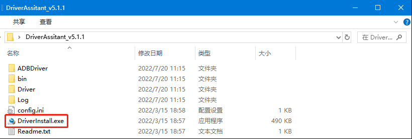

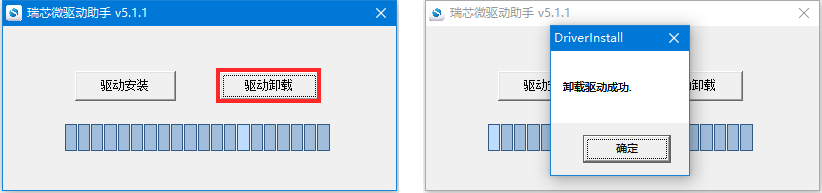

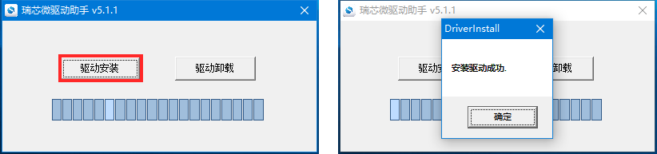

**连接端侧板：** 解压烧写工具，运行 `RKDevTool.exe`，停留在「下载镜像」页。然后拔下腕部相机，因为烧写口就是平时连接腕部相机的 USB 口（端侧板上沿左侧的那个）。烧写线一端接该接口，另一端接电脑。

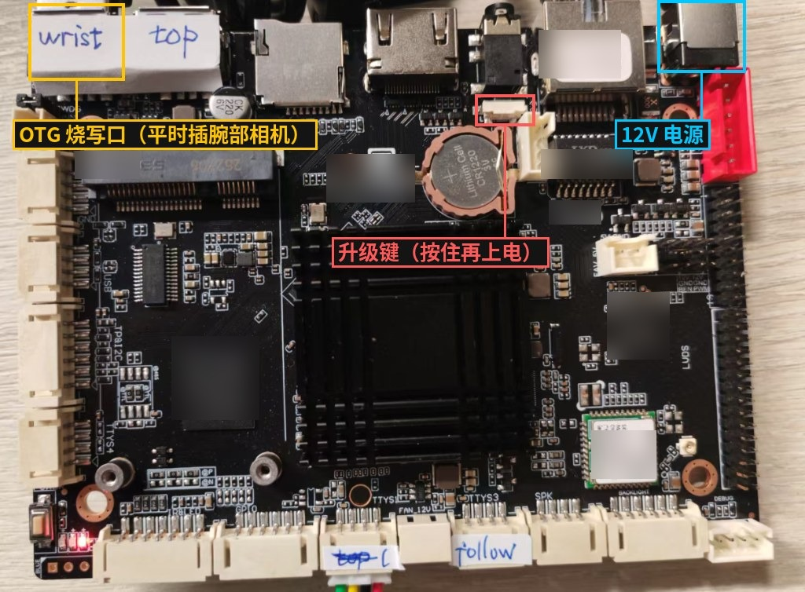

进入烧写模式有两种方法：

- **端侧板能正常开机**：在网页终端中执行 `reboot loader`
- **端侧板无法启动，或为新板**：先断电，按住升级键不放，接上 12V 电源，待工具底部出现「发现一个LOADER设备」后再松开

**烧写：** 工具底部显示「发现一个LOADER设备」后，按下图设置，然后点击「执行」：

- 第 2 行 `firmware`：勾选，地址保持 `0x00000000`，点击该行路径栏右侧的按钮，选择解压得到的 `.img`
- 第 1 行 `rkbin`：不勾选
- 勾选「强制按地址写」

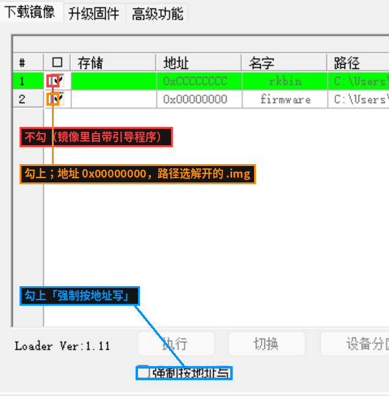

右侧日志开始滚动，写入完成后端侧板自动重启。过程中不要拔线、不要断电；如果失败，重新进入烧写模式再烧写一遍。

**首次开机：** 接回腕部相机，接通电源。首次开机会把系统分区扩展到整片 eMMC，耗时比平时略长。网线的出厂地址为固定 IP `192.168.1.50`，也可以连接热点设置网络。端侧板联网后，按 1.2 节执行一次一键安装，将端侧板上的内容升级到最新版。

## 1.2 一条命令安装，一条命令升级

端侧板上用到的全部内容都随 LeRobot 一同发布：系统设置、机械臂与相机的固定名字、六个网页服务和 LeRobot 环境。新端侧板、刚烧写完镜像的端侧板，以 root 登录后执行一条命令即可完成安装（端侧板需能访问外网）：

```bash
curl -fsSL https://raw.githubusercontent.com/Xbotics-Embodied-AI-club/lerobot/xbotics-v0.6.1/src/lerobot/xbotics/board/bootstrap.sh | bash
```

它先安装 uv（管理 Python 与依赖的工具），在 `/root/xbotics` 建立 LeRobot 环境，再由环境中的 LeRobot 安装其余内容。输出的最后一行为 `· 安装完成：用 xbotics-config status 查看各服务状态`，即表示完成。已安装的内容保持不变，缺少的补齐，旧的更新，因此对任何一块端侧板都可以执行这条命令。

此后维护版更新时，在端侧板上执行一条命令即可：

```bash
xbotics-config update
```

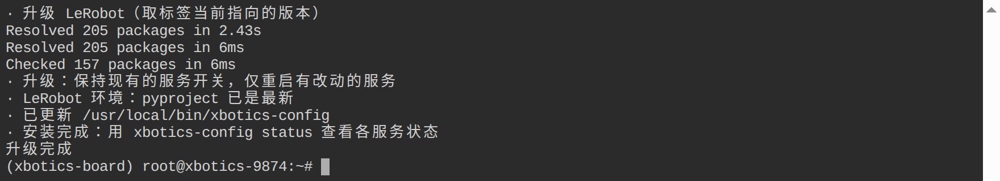

它将 LeRobot 更新到最新版本，再按新版重新安装端侧板上的其余内容，只修改有变化的部分。网页服务的开关、修改过的密码、你自行用 `uv add` 安装的包都会保留。也可以在网页终端或 VS Code 的终端中执行：需要重启这些服务时，会在升级完成后再重启，页面短暂断开，刷新即可。训练电脑需同步升级，见 [2.7 节](#train-env-upgrade)。

## 1.3 配网

端侧板始终开启一个热点，名称为 `Xbotics-` 加四位字符（每块端侧板不同），无需密码。电脑或手机连接该热点后，会弹出「星禾套件 · 网络设置」页；如未弹出，在浏览器中打开 `http://10.42.0.1`。如果提示「此网络无法访问互联网」，请选择保持连接：该热点仅供此页面使用，本身不连通外网。

页面顶部的三块信息每两秒刷新一次，右上角的标签显示状态：网线与 Wi-Fi 为绿色「可访问外网」、橙色「无法访问外网」或红色「未连接」，下方为获得的地址；本热点显示热点的名称与地址。在手机上打开时为单列，在电脑上打开时三块并排。

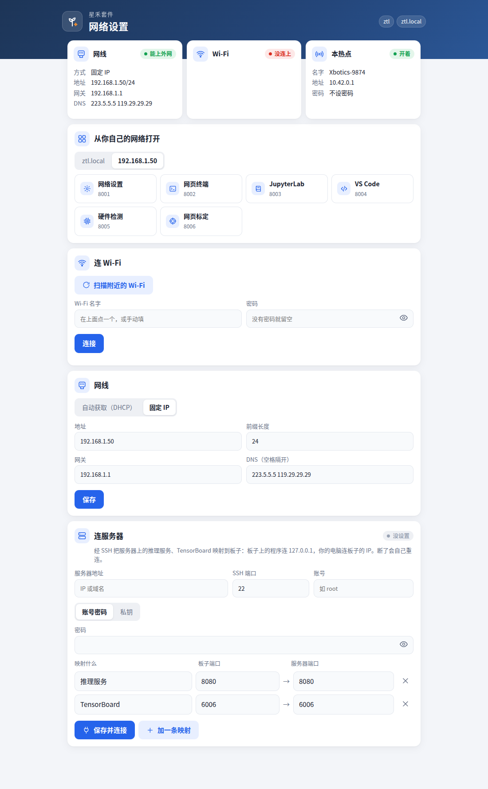

**连接 Wi-Fi：** 点击「扫描附近的 Wi-Fi」，列表按信号强弱排序，右侧格数表示信号强度，带锁的需要密码。选择你的 Wi-Fi，填写密码（右侧的眼睛图标可显示密码），点击「连接」。屏幕底部显示 `已连接 …，地址 …` 即表示成功，点击该提示可将其关闭。连接过程中热点不会中断，页面保持打开；密码错误时会给出提示，已保存的 Wi-Fi 不受影响。连接过的 Wi-Fi 列在「已保存」中，端侧板开机后自动连接；不再需要时，点击名称旁的 ×。标有「需账号登录，暂不支持」的网络需要用户名登录，目前无法连接。

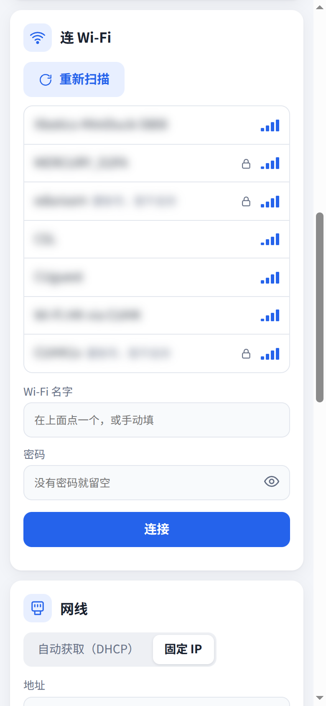{width=320px}

**设置网线：** 出厂设置为固定 IP，地址 `192.168.1.50`、网关 `192.168.1.1`。如果你的路由器恰好是 `192.168.1.x` 网段，接上网线即可使用。若不是该网段，点击「自动获取（DHCP）」，或点击「固定 IP」并填写你所在网络的地址、前缀长度、网关与 DNS，再点击「保存」；哪一项填写有误，页面会直接指出。如果是通过网线打开的本页面，保存时连接会短暂中断；改为固定 IP 后需使用新地址打开。

**从你的网络中打开端侧板：** 端侧板联网后，页面上「从你的网络中打开」一栏列出六个网页。上方一排是端侧板的各个地址，选择哪个地址，下方的链接就使用哪个地址。将电脑切换回你自己的 Wi-Fi 或网线，再点击这些链接。带 `.local` 的地址需要电脑支持此类名称，无法打开时请选择 IP 地址。

(connect-server)=
## 1.4 连接训练电脑

推理服务与训练曲线都在训练电脑上。在网络设置页的「连接服务器」一栏连接训练电脑后，端侧板会将训练电脑上的端口映射到本机。训练电脑需先开启 SSH 服务，见 [2.5 节](#train-env-ssh)。

1. 填写三项：**服务器地址**（训练电脑的 IP）、**SSH 端口**（通常为 22）、**账号**（训练电脑上的用户名）。
2. 选择登录方式：**账号密码**，填写该账号的密码；**私钥**，将私钥完整粘贴进去（从 `-----BEGIN` 行到 `-----END` 行），或点击「选择文件」，私钥带口令时填写在下方。
3. 下方为要映射的端口，默认两条，一般无需修改：

| 映射名称 | 端侧板端口 | 训练电脑上的端口 | 用途 |
| --- | --- | --- | --- |
| 推理服务 | 8080 | 8080 | 部署时端侧板上的程序连接它 |
| TensorBoard | 6006 | 6006 | 查看训练曲线 |

4. 点击「保存并连接」。几秒后右上角变为绿色「已连接」，下方每条映射标出状态：「畅通」表示训练电脑上该端口有服务响应；「服务器上该端口无服务」表示连接已建立，只是训练电脑上尚未启动该服务。

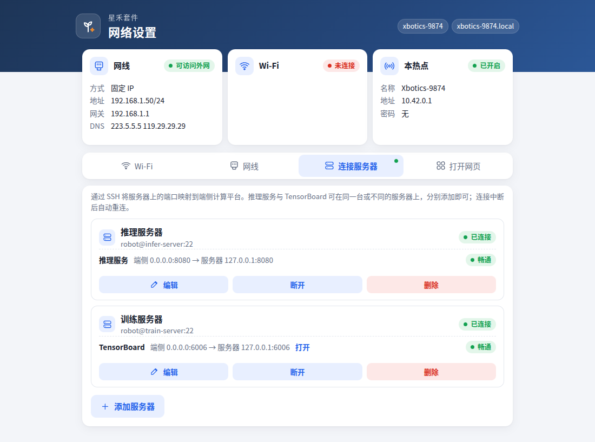

连接后，端侧板上的程序访问 `127.0.0.1:8080`，即访问训练电脑的推理服务；在任意一台电脑上打开 `http://<端侧板IP>:6006`，即为训练电脑上的 TensorBoard，也可以点击映射旁的「打开」。网络中断或训练电脑重启后，端侧板会自动重新连接；端侧板重启后也会自动连接。不再使用时点击「断开」，此后开机不再自动连接。

连接失败时，页面以中文给出原因：「登录被拒」表示账号、密码或私钥不正确，此时端侧板不会用错误的密码反复重试（反复重试可能导致服务器锁定该账号），修改后再次点击「保存并连接」；「私钥口令不对」「私钥格式不对」，请检查口令，或重新粘贴完整私钥；「服务器指纹已变化」表示训练电脑重新安装过系统，再次点击「保存并连接」即可重新识别；「找不到该服务器地址」「连不上服务器」表示地址填写错误，或端侧板所在网络无法访问这台电脑；「服务器不允许端口转发」需要在训练电脑的 `/etc/ssh/sshd_config` 中设置 `AllowTcpForwarding yes`。

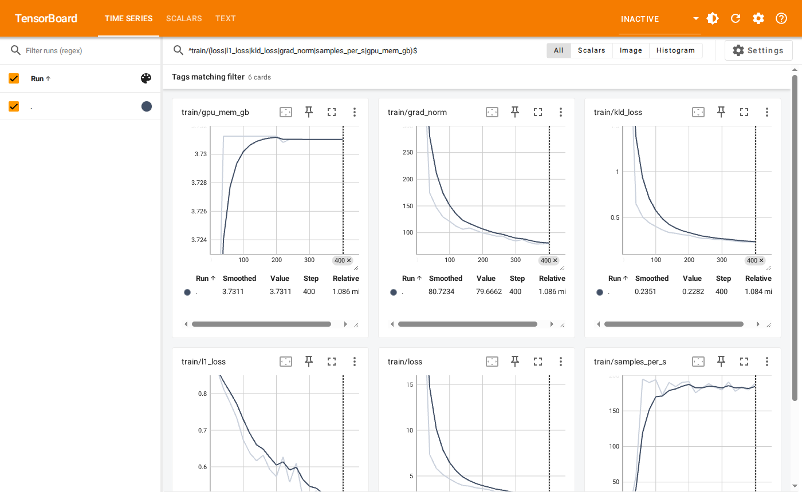

## 1.5 网页终端

在浏览器中打开 `http://<端侧板IP>:8002`，在 `login:` 后输入 `root`，再输入密码 `123456`（输入时屏幕不显示）。提示符前出现 `(xbotics-board)`，表示已进入 LeRobot 环境，后续命令可以直接执行。

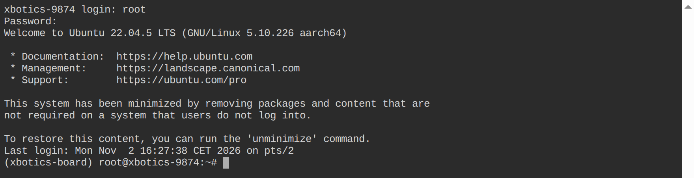

网页终端的用法与普通终端相同：可以粘贴命令，按 `Ctrl+C` 中断正在运行的命令。**关闭该网页时，其中正在运行的命令也会随之结束**，因此录制数据、运行推理期间不要关闭它。

## 1.6 VS Code 与 JupyterLab

**浏览器版 VS Code** 适合查看文件、修改代码、编写需要反复使用的脚本。在浏览器中打开 `http://<端侧板IP>:8004`，输入密码 `123456`。

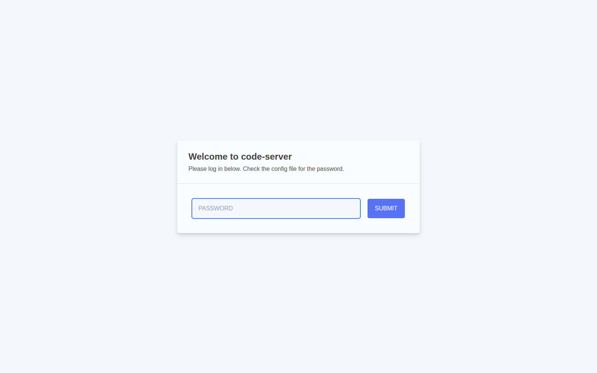

- **查看文件**：左侧 Explorer 显示端侧板上的文件；切换目录可使用菜单 File → Open Folder，或在网址后添加 `?folder=/root/data`
- **修改文件**：打开后直接编辑，按 `Ctrl+S` 保存
- **运行 Python 文件**：打开后点击编辑区右上角的 ▷，默认使用 LeRobot 环境中的 Python
- **终端**：菜单 Terminal → New Terminal，录制数据、运行推理的命令也可以在此执行

示例：在 `~/xbotics` 中新建 `check_board.py`，写入下面几行，点击 ▷。

```python
"""板子自检：用的是哪个 Python、LeRobot 版本、四个固定名字各指向什么。"""

import os
import sys

import lerobot

print("Python:", sys.executable)
print("LeRobot:", lerobot.__version__)
for name in ("follower", "leader", "top", "wrist"):
    path = f"/dev/xbotics/{name}"
    print(f"{path:24s}", "->", os.path.realpath(path) if os.path.exists(path) else "没插")
```

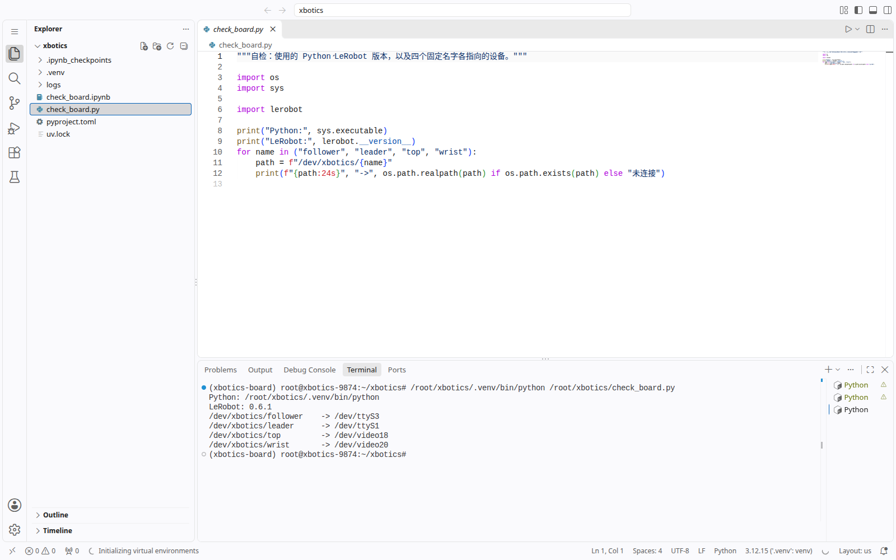

**JupyterLab** 适合边运行边查看结果，例如读取一组关节读数、查看一帧相机画面。在浏览器中打开 `http://<端侧板IP>:8003`，输入密码 `123456`。

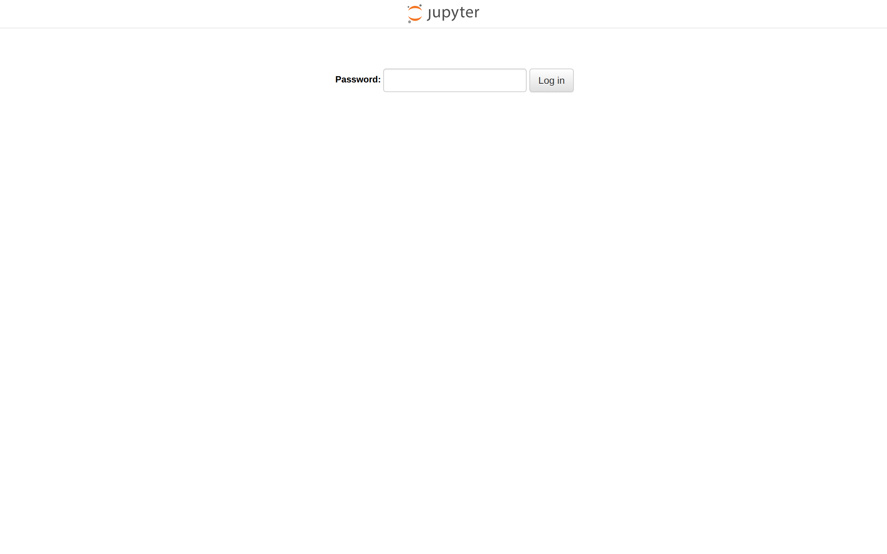

- **新建 notebook**：点击左上角蓝色的 `+`，在 Notebook 下选择 `Python 3 (ipykernel)`，可直接 `import lerobot`
- **运行**：在单元格中编写代码，按 `Shift+Enter` 运行该单元格
- **终端**：蓝色 `+` → Terminal

将上面 `check_board.py` 的代码粘贴到一个单元格中，按 `Shift+Enter`：

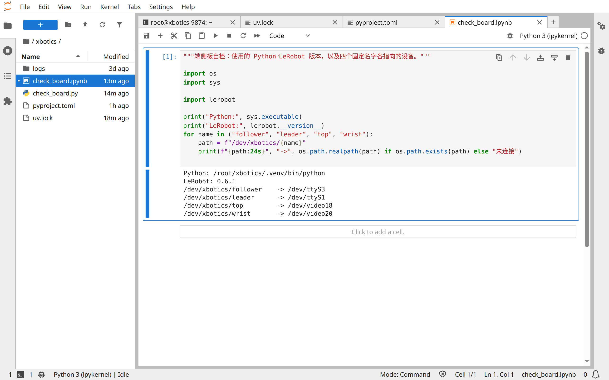

关闭网页后，notebook 的内核仍在后台运行，变量保持不变，下次打开可以继续使用，这一点与网页终端不同。不再使用时，通过菜单 Kernel → Shut Down Kernel 关闭内核：导入 LeRobot 后，一个内核约占用 0.4 GB 内存。

(xbotics-config)=
## 1.7 xbotics-config

8002 至 8006 五个网页服务用 `xbotics-config` 开关，在网页终端中执行：

```bash
xbotics-config
```

随后弹出菜单：用方向键上下选择，空格勾选或取消，回车生效。勾选的服务保持开启并开机自启；取消勾选的服务立即关闭，开机也不再启动。8001 网络设置页不在菜单中，它始终开启，否则将无法通过热点进入端侧板修改网络。

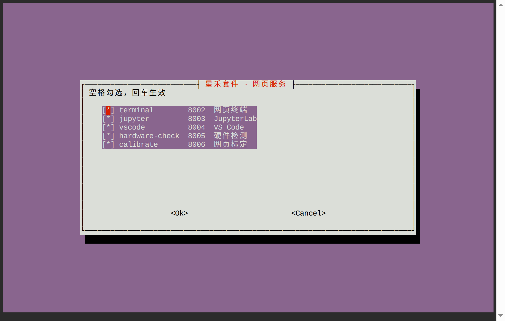

也可以不使用菜单，直接执行命令：

```bash
xbotics-config status
xbotics-config disable calibrate
xbotics-config enable calibrate
```

`status` 列出各服务是否开机自启、是否正在运行及其网址。`enable` 与 `disable` 后跟服务名：`terminal`、`jupyter`、`vscode`、`hardware-check`、`calibrate`，`all` 表示全部。

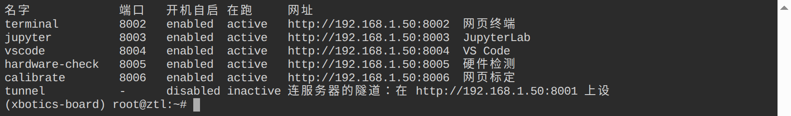

最后一行 `tunnel` 是 1.4 节连接训练电脑所用的隧道，在网络设置页上开关。

如果在网页终端中关闭 `terminal`，页面会立即断开；需要重新开启时，在 VS Code 的终端中执行 `xbotics-config enable terminal`。不需要的服务可以关闭以节省内存：硬件检测、网页标定各占用约 0.3 GB。
