# 第 1 章 端侧板使用

星禾套件的主从两条机械臂和两路相机都接在一块 RK3566 端侧板上。这块板子不接显示器，所有操作都在浏览器里完成：你只需要一台和板子在同一局域网、能打开网页的电脑，不用装任何软件。

板子上的网页服务端口连号，顺序是「配网 → 终端 → Jupyter → VS Code → 硬件检测 → 标定」，记住开头的 8001 就行：

| 网址 | 做什么 | 什么时候能打开 |
| --- | --- | --- |
| `http://10.42.0.1` | 网络设置：连 Wi-Fi、设网线、看 IP | 连着板子的热点时 |
| `http://<板子IP>:8001` | 同一个网络设置页 | 板子开机就能打开 |
| `http://<板子IP>:8002` | 网页终端 | 服务开着时 |
| `http://<板子IP>:8003` | JupyterLab | 服务开着时 |
| `http://<板子IP>:8004` | 浏览器版 VS Code | 服务开着时 |
| `http://<板子IP>:8005` | 硬件检测 | 服务开着时 |
| `http://<板子IP>:8006` | 网页标定 | 服务开着时 |
| `http://<板子IP>:8007` | 推理控制台 | 运行 `lerobot-inference-console` 的时候 |
| `http://<板子IP>:9090` | 录制预览：相机画面和关节曲线 | 录数据的时候 |

8002 到 8006 默认都开着，可以用 `xbotics-config` 开关，见 [1.5 节](#xbotics-config)。板子的用户名是 `root`，默认密码是 `123456`，网页终端、JupyterLab、VS Code 和 SSH 都用它。只在自己的局域网里用板子，不要把这些端口映射到公网。

## 1.1 烧写镜像

板子到手已经装好系统时，可以跳过这一节。新板装系统、重装系统、板子起不来要恢复，都照这一节做。

烧写会清掉板子上的全部内容，包括系统、录的数据和机械臂标定，要留的先拷走。

**准备：**

| 要准备的 | 说明 |
| --- | --- |
| 电脑 | Windows 10 / 11，至少一个 USB 口 |
| 烧写线 | USB-A 公对公数据线，用带屏蔽的 |
| 电源 | 板子的 12V 电源（DC 插头 5.5×2.5 mm） |
| 镜像 | 到 [Hugging Face](https://huggingface.co/Harrysunshine?search_datasets=rk3566) 下载最新版出厂镜像，用 7-Zip 解压成 `.img` 文件 |
| 驱动 | {download}`DriverAssitant_v5.13.zip <attachments/DriverAssitant_v5.13.zip>` |
| 烧写工具 | {download}`RKDevTool_v3.37_for_window.7z <attachments/RKDevTool_v3.37_for_window.7z>` |

镜像仓库是受限访问：用自己的 Hugging Face 账号登录，在页面上点申请，批准后才能下载。

**装驱动（每台电脑一次）：** 解压驱动，运行里面的 `DriverInstall.exe`。先点「驱动卸载」，等弹出「卸载驱动成功」；再点「驱动安装」，等弹出「安装驱动成功」。先卸再装，是因为电脑上别的版本的旧驱动会让工具认不出板子。

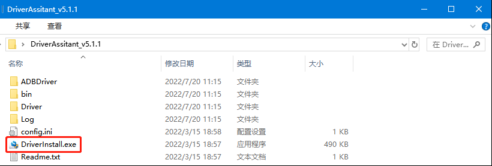

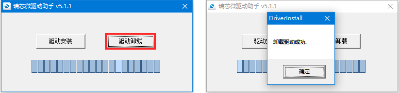

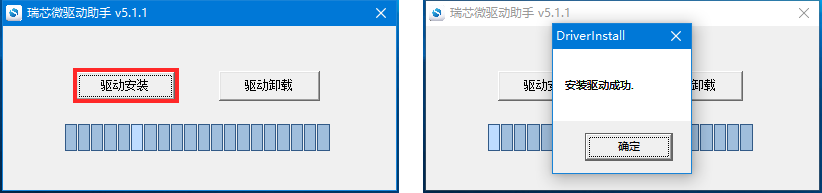

**连接板子：** 解压烧写工具，运行 `RKDevTool.exe`，停在「下载镜像」页。然后拔掉腕部相机，因为烧写口就是平时插腕部相机的那个 USB 口（板子上沿左边那个）。烧写线一头插这个口，一头插电脑。

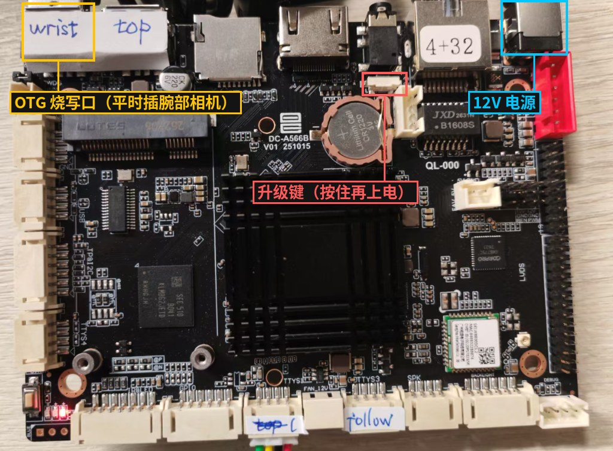

进烧写模式有两种办法：

- **板子能正常开机**：在网页终端里敲 `reboot loader`
- **板子起不来，或是新板**：先断电，按住升级键不放，插上 12V 电源，等工具底部出现「发现一个LOADER设备」后再松手

**烧写：** 工具底部显示「发现一个LOADER设备」后，按下图设置，然后点「执行」：

- 第 2 行 `firmware`：勾上，地址保持 `0x00000000`，点这一行路径栏右边的按钮，选解压出来的 `.img`
- 第 1 行 `rkbin`：不勾
- 勾上「强制按地址写」

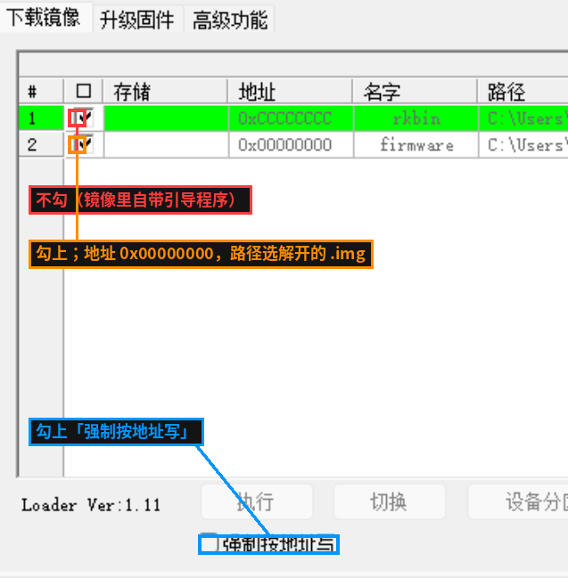

右边的日志开始滚动，写完板子自动重启。中途不要拔线、不要断电，失败了就重新进烧写模式再烧一遍。

**第一次开机：** 插回腕部相机，上电。第一次开机会把系统分区扩到整片 eMMC，比平时多等一会儿。网线的出厂地址是固定 IP `192.168.1.50`，也可以连热点设置网络。

## 1.2 配网

板子一直开着一个热点，名字是 `Xbotics-` 加四位（每块板不同），不用密码。电脑或手机连上它，会弹出「星禾套件 · 网络设置」页。没弹出来就在浏览器打开 `http://10.42.0.1`。如果提示「此网络无法访问互联网」，选保持连接：热点只给这个页面用，本来就不通外网。

页面顶上三块每两秒刷新一次：网线和 Wi-Fi 显示连没连上、能不能上外网、拿到的地址；本热点显示热点的名字和地址。

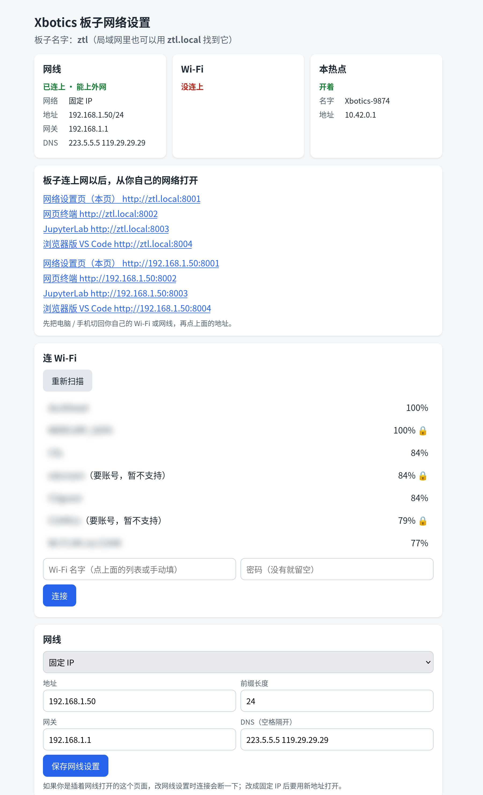

**连 Wi-Fi：** 点「扫描附近的 Wi-Fi」，在列表里点你的 Wi-Fi，填密码，点「连接」。屏幕底边显示 `已连上 …，地址 …` 就好了。连的过程中热点不断，页面一直开着。连上过的 Wi-Fi 列在「已保存的 Wi-Fi」，板子开机自动连。标着「要账号，暂不支持」的网络需要用户名登录，连不了。

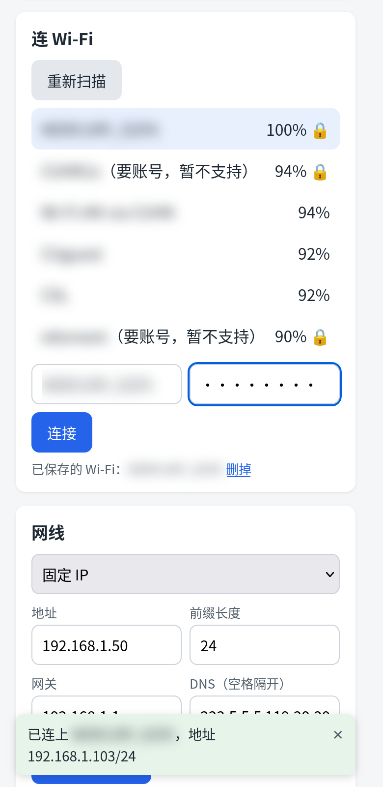

**设网线：** 出厂是固定 IP，地址 `192.168.1.50`、网关 `192.168.1.1`。你的路由器正好是 `192.168.1.x` 网段时，插上网线就能用。不是这个网段时，在这里改成「自动获取地址」，或填你网络里的固定 IP。如果是插着网线打开的这个页面，保存时连接会断一下；改成固定 IP 后要用新地址打开。

**从你自己的网络打开板子：** 板子连上网以后，页面上「从你自己的网络打开」一栏会列出六个网址。把电脑切回你自己的 Wi-Fi 或网线，再点这些地址。带 `.local` 的那一组要电脑支持这种名字，打不开就用 IP 的那几组。

## 1.3 网页终端

浏览器打开 `http://<板子IP>:8002`，在 `login:` 后面输入 `root`，再输入密码 `123456`（输入时屏幕上不显示）。提示符前面有 `(xbotics-board)`，说明已经在 LeRobot 环境里，后面的命令可以直接敲。

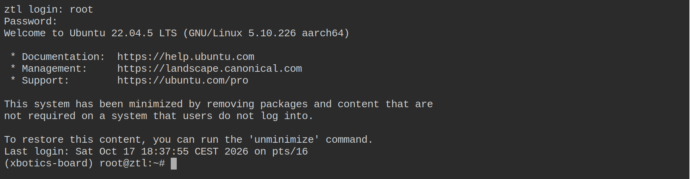

网页终端和普通终端一样，命令可以粘贴进去，`Ctrl+C` 中断正在运行的命令。**关掉这个网页，里面正在运行的命令也会跟着结束**，所以录数据、推理时别关它。

## 1.4 VS Code 和 JupyterLab

**浏览器版 VS Code** 适合看文件、改代码、写要反复用的脚本。浏览器打开 `http://<板子IP>:8004`，输入密码 `123456`。

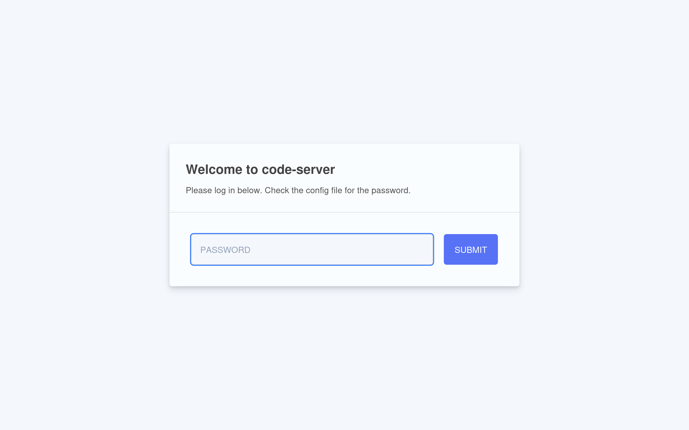

- **看文件**：左边 Explorer 是板子上的文件；换目录用菜单 File → Open Folder，或在网址后面加 `?folder=/root/data`
- **改文件**：点开直接改，`Ctrl+S` 保存
- **运行 Python 文件**：打开后点编辑区右上角的 ▷，默认用 LeRobot 环境里的 Python
- **终端**：菜单 Terminal → New Terminal，录数据、推理的命令也可以在这里敲

试一下：在 `~/xbotics` 里新建 `check_board.py`，写进下面几行，点 ▷。

```python
"""板子自检：用的是哪个 Python、LeRobot 版本、四个固定名字各指向什么。"""

import os
import sys

import lerobot

print("Python:", sys.executable)
print("LeRobot:", lerobot.__version__)
for name in ("follower", "leader", "top", "wrist"):
    path = f"/dev/xbotics/{name}"
    print(f"{path:24s}", "->", os.path.realpath(path) if os.path.exists(path) else "没插")
```

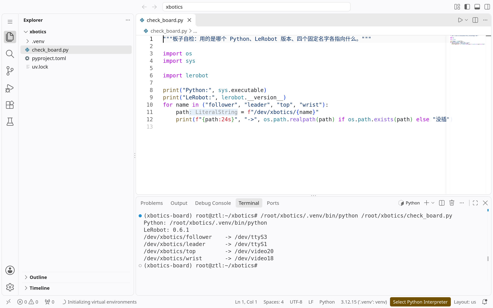

**JupyterLab** 适合边试边看结果，比如读一组关节读数、看一帧相机画面。浏览器打开 `http://<板子IP>:8003`，输入密码 `123456`。


- **新建 notebook**：左上角蓝色的 `+` → Notebook 下点 `Python 3 (ipykernel)`，`import lerobot` 直接能用
- **运行**：在格子里写代码，`Shift+Enter` 运行这一格
- **终端**：蓝色 `+` → Terminal

把上面 `check_board.py` 的代码贴进一格，`Shift+Enter`：

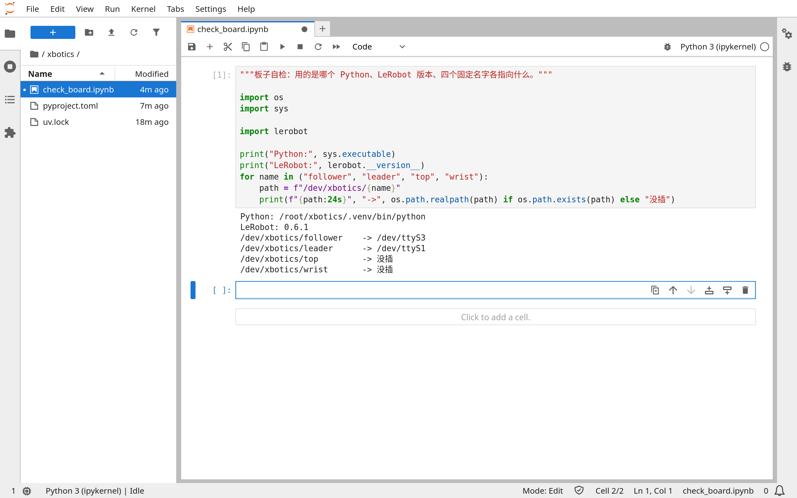

关掉网页后，notebook 的内核还在后台，变量都在，下次打开接着用。这一点和网页终端相反。不用了就在菜单 Kernel → Shut Down Kernel 关掉，因为导入 LeRobot 后一个内核约占 0.4 GB 内存。

(xbotics-config)=
## 1.5 xbotics-config

8002 到 8006 五个网页服务用 `xbotics-config` 开关，在网页终端里敲：

```bash
xbotics-config
```

弹出一个菜单：方向键上下选，空格勾选或取消，回车生效。勾上的服务开着、开机自动起来；取消勾选的马上关掉、开机也不起。8001 网络设置页不在菜单里，它一直开着，否则就没法从热点进板子改网络。

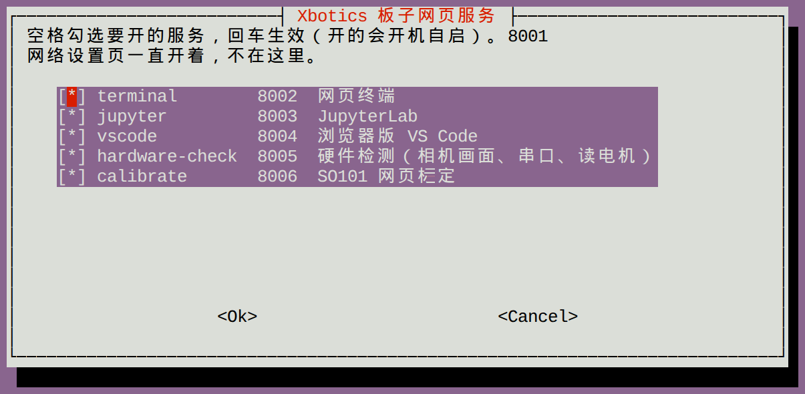

不想用菜单，也可以直接敲命令：

```bash
xbotics-config status
xbotics-config disable calibrate
xbotics-config enable calibrate
```

`status` 列出每个服务开没开、在不在跑、网址。`enable` 和 `disable` 后面跟名字：`terminal`、`jupyter`、`vscode`、`hardware-check`、`calibrate`，写 `all` 就是全部。

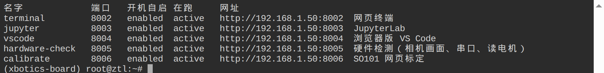

如果在网页终端里关掉 `terminal`，页面会马上断开，要再打开就从 VS Code 的终端里敲 `xbotics-config enable terminal`。用不上的服务可以关掉省内存：硬件检测、网页标定各占约 0.3 GB。

## 1.6 升级 LeRobot

维护版修了问题时，标签 `xbotics-v0.6.1` 会前移到新的提交。板子上这样跟上：

```bash
cd ~/xbotics && uv lock --upgrade-package lerobot && uv sync
systemctl restart xbotics-hardware-check xbotics-calibrate-web
```

只敲 `uv sync` 跟不上，因为 `uv.lock` 记着安装时标签指向的提交，要用 `uv lock --upgrade-package lerobot` 重新问标签现在指向哪。第二行让网页硬件检测和网页标定用上新版。x86 电脑要同样升级，保持两边是同一个提交。

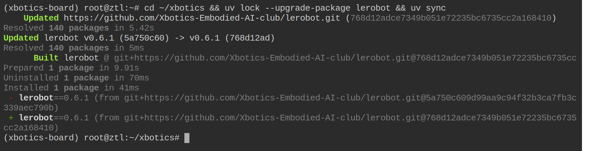
