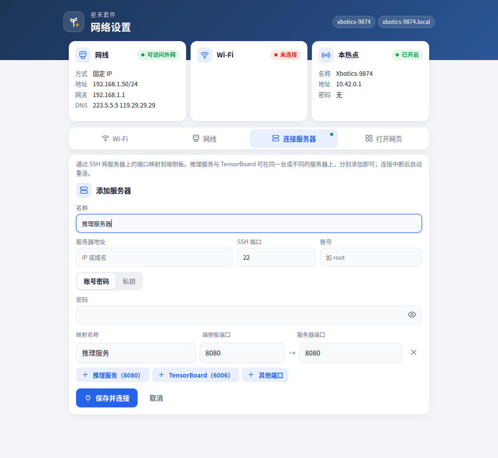
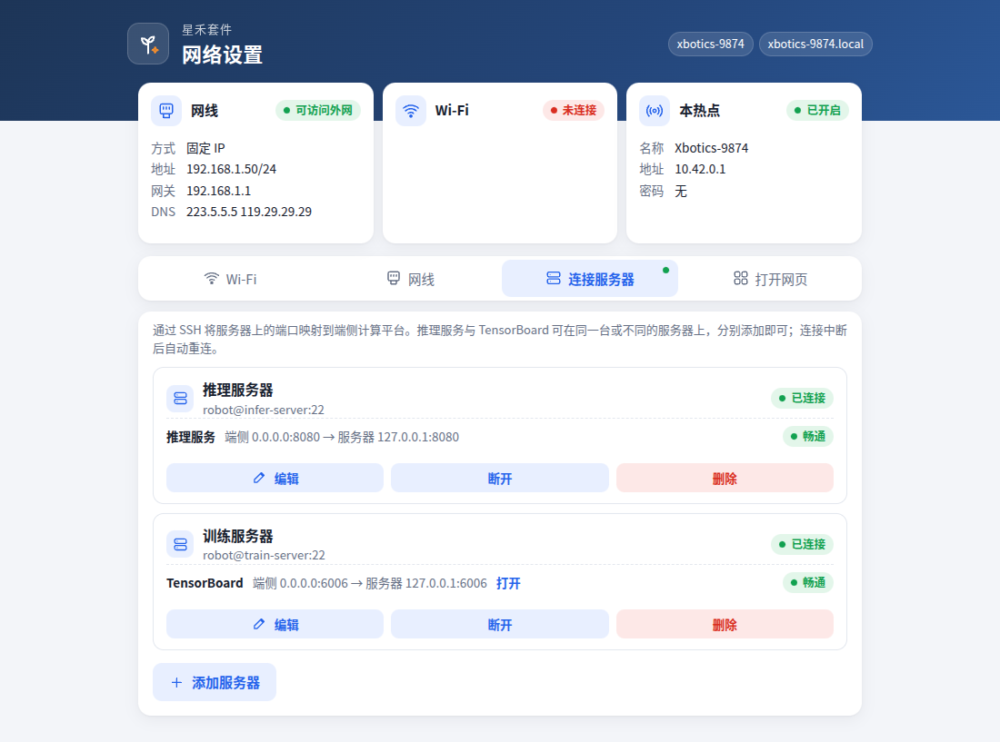
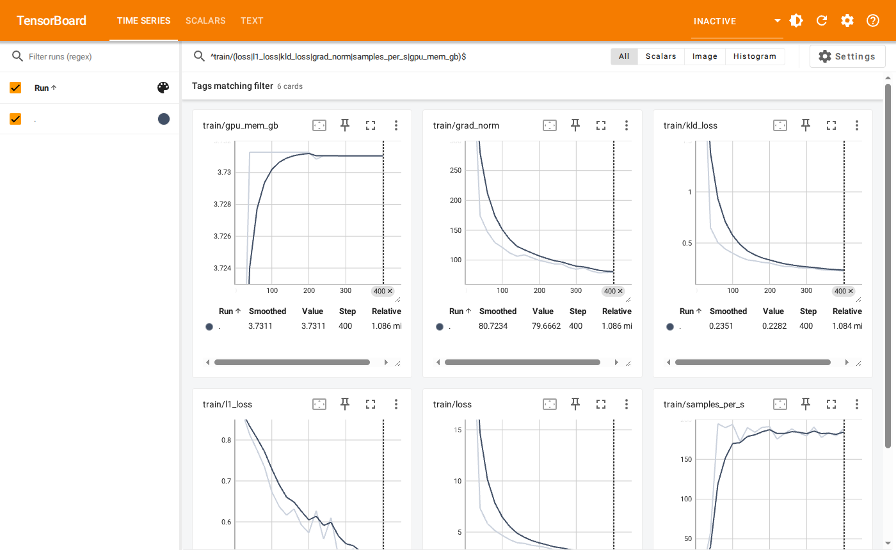
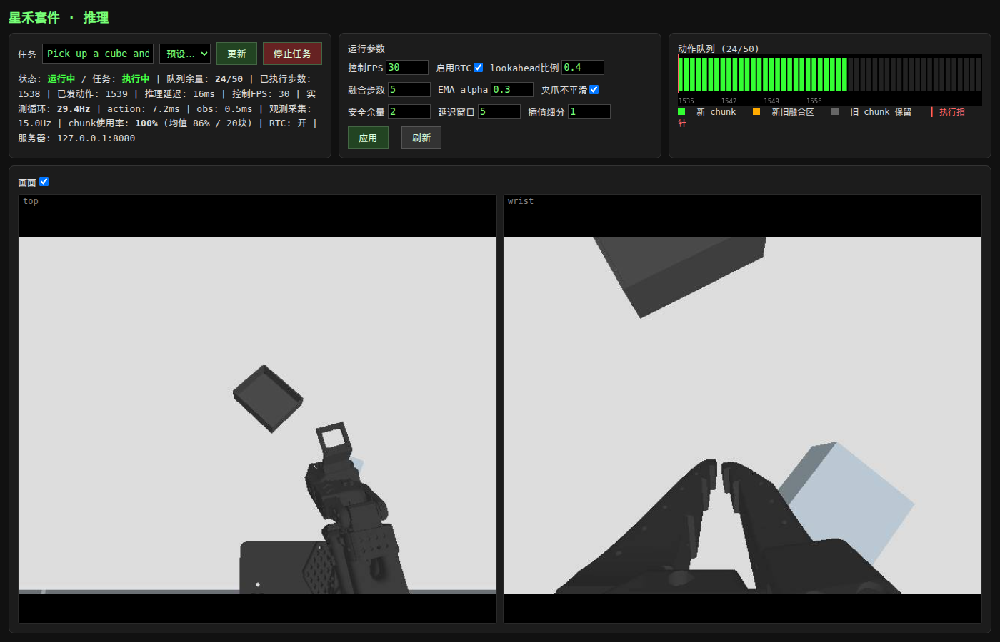

# 第 5 章 推理部署

部署是让训练好的模型控制真机。模型在训练电脑的显卡上运行，端侧计算平台负责读取相机画面与关节读数、执行动作，两者经网络协同：

1. 训练电脑上的**推理服务**加载模型，收到观测后计算出接下来的一段动作；
2. 端侧计算平台上的**推理控制台**每秒约 30 次读取两路相机与六个关节，在后台把观测发给推理服务，并逐一执行收到的动作；
3. 当前一段动作用完之前，下一段已经到达，机械臂动作连贯。

<video controls muted playsinline preload="metadata" poster="_static/poster/deploy.jpg" src="_static/media/deploy.mp4"></video>

本章按顺序启动推理服务、让端侧计算平台连接训练电脑、启动推理控制台。开始前请确认：已完成前四章，两边的 LeRobot 为同一版本，并有一个训练好的模型：第 4 章训练得到的模型，或我们发布的 [`Harrysunshine/so101-act-sim-real-cube`](https://huggingface.co/Harrysunshine/so101-act-sim-real-cube)。

(deploy-server)=
## 5.1 在训练电脑上启动推理服务

在训练电脑上进入环境（[2.2 节](#train-env-setup)），执行：

```bash
python -m lerobot.async_inference.policy_server --host=127.0.0.1 --port=8080 --fps=30
```

`--host=127.0.0.1` 表示推理服务只在本机监听，端侧计算平台经 5.2 节的连接访问它，电脑无需对外开放端口。推理服务不预先加载模型，端侧计算平台连接时指定使用哪个模型。部署期间保持这个终端打开，按 `Ctrl+C` 停止。

(connect-server)=
## 5.2 让端侧计算平台连接训练电脑

在网络设置页（[1.2 节](#board-network)）的「连接服务器」标签中添加训练电脑，端侧计算平台会把电脑上的推理服务与 TensorBoard 映射到本机。电脑需先开启 SSH 服务，见 [2.5 节](#train-env-ssh)。推理与训练可以在同一台电脑上，也可以在不同的电脑上，每台电脑分别添加一次。

1. 点击「添加服务器」，填写**名称**（便于区分，如「推理服务器」「训练服务器」）、**服务器地址**（电脑的 IP）、**SSH 端口**（通常为 22）、**账号**（电脑上的用户名）。
2. 登录方式选择**账号密码**，填写该账号的密码。也可以选择**私钥**，将私钥完整粘贴进去，或点击「选择文件」。
3. 在表单下方点击这台电脑提供的服务，添加映射：

| 按钮 | 端侧端口 | 电脑上的端口 | 用途 |
| --- | --- | --- | --- |
| 推理服务（8080） | 8080 | 8080 | 推理控制台经它连接推理服务 |
| TensorBoard（6006） | 6006 | 6006 | 查看训练曲线 |



4. 点击「保存并连接」。几秒后这台电脑的卡片右上角变为绿色「已连接」，每条映射标出状态：「畅通」表示电脑上该端口的服务已在运行；「服务器上该端口无服务」表示连接已建立，只是电脑上尚未启动该服务。



连接后，端侧计算平台上的程序访问 `127.0.0.1:8080`，即访问训练电脑上的推理服务；在任意一台电脑的浏览器中打开 `http://<端侧IP>:6006`，即为训练电脑上的 TensorBoard，也可以点击映射旁的「打开」。网络中断或电脑重启后会自动重新连接，端侧计算平台重启后也会自动连接。每张卡片可以「编辑」「断开」「删除」。

连接失败时，卡片中以中文给出原因：

| 提示 | 处理 |
| --- | --- |
| 登录被拒 | 账号或密码不正确。修改后再次点击「保存并连接」；端侧计算平台不会用错误的密码反复重试，避免电脑锁定该账号 |
| 找不到该服务器地址、连不上服务器 | 地址填写错误，或端侧计算平台与这台电脑不在同一网络 |
| 服务器指纹已变化 | 电脑重新安装过系统，再次点击「保存并连接」即可 |



(deploy-console)=
## 5.3 启动推理控制台

在端侧计算平台的网页终端（[1.1 节](#xbotics-config)）中，先设置相机变量（[1.7 节](#camera-var)），再执行：

```bash
lerobot-inference-console \
  --robot.type=so101_follower --robot.port=/dev/xbotics/follower --robot.id=follower \
  --robot.cameras="$CAMERAS" \
  --task="Pick up a cube and place in the bin" \
  --policy_type=act --pretrained_name_or_path=Harrysunshine/so101-act-sim-real-cube --policy_device=cuda \
  --server_host=127.0.0.1 --server_port=8080 --actions_per_chunk=50 --fps=30
```

需要按自己的模型修改的三项：

| 参数 | 含义 |
| --- | --- |
| `--pretrained_name_or_path` | Hugging Face 上的模型名，或训练电脑上模型目录的绝对路径（见下） |
| `--policy_type` | 模型的类型，与训练时一致，如 `act`、`smolvla` |
| `--task` | 任务描述。接受语言指令的模型（如 SmolVLA）据此决定做什么 |

使用第 4 章训练的模型时，`--pretrained_name_or_path` 填写训练电脑上的绝对路径（[4.4 节](#train-output)），该路径由训练电脑读取，例如：

```text
/home/<用户名>/xbotics/outputs/train/act_pick_cube/checkpoints/last/pretrained_model
```

启动后，推理服务加载模型（首次需要下载，耗时稍长），随后机械臂开始按模型的动作运动。在浏览器中打开 `http://<端侧IP>:8007`，即可看到相机画面、任务状态、动作队列与推理延迟：点击「停止任务」，机械臂停止执行动作，按钮变为「启动任务」，点击即继续；在「任务」框中修改任务描述后点击「更新」，下一次推理即使用新的描述。按网页终端中的 `Ctrl+C` 结束部署。



推理控制台没有登录验证，同一网络中的任何人都能打开，请只在自己的局域网中使用。

## 5.4 第一次上真机

- 清空工作区，只留下物体与料盒；相机位置、光线与物体摆放尽量与录制数据时一致
- 手放在电源开关旁，模型第一次运行时动作可能比预想的大，发现异常立即断电
- `--robot.id` 须与标定时一致，`$CAMERAS` 中的相机名须与训练所用数据集一致

## 5.5 没有机械臂时用仿真

把推理控制台连接的机器人换成 SO-101 仿真，整条部署链路即可在训练电脑上走通，适合先确认模型与推理服务工作正常。推理服务按 5.1 节启动，在训练电脑上另开一个终端，进入环境后执行：

```bash
python -c "import so101_sim.config_lerobot_robot; from lerobot.xbotics.inference_console.client import main; main()" \
  --robot.type=so101_sim --task="Pick up a cube and place in the bin" \
  --policy_type=act --pretrained_name_or_path=Harrysunshine/so101-act-sim-real-cube --policy_device=cuda \
  --server_host=127.0.0.1 --server_port=8080 --actions_per_chunk=50 --fps=30
```

第一行先导入仿真机器人的配置，其余参数与真机相同。在浏览器中打开 `http://localhost:8007`，界面与 5.3 节的图相同：画面中是仿真里的两路相机，状态为「运行中」、动作队列持续刷新，即表示模型与推理服务工作正常。

到这里，你已经走完了从硬件准备、录制数据、训练到部署的整条流程。录制数据时如何设计任务、训练时如何选择模型与调整参数、上真机前如何评测，属于 Xbotics 具身智能课程的内容。
