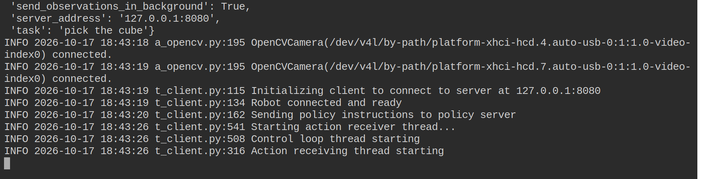

# 第 9 章 部署

最后一步是让模型控制真机。板子算力不够跑模型，所以推理放在 x86 电脑上：板子把相机画面和关节读数发过去，电脑算出一段动作发回来，板子再逐个执行。

<video controls muted playsinline preload="metadata" src="_static/media/deploy.mp4"></video>

整个过程分两头：

- **x86 电脑上跑 `policy_server`**：加载模型、算动作
- **板子上跑 `robot_client`**：读相机和关节，发给电脑，把收到的动作交给机械臂

两边的 LeRobot 必须是同一个版本。

## 9.1 电脑上启动推理服务

板子要通过 SSH 连到电脑，所以电脑上先装好 SSH 服务，并记下 IP：

```bash
sudo apt install -y openssh-server
hostname -I
```

然后启动推理服务：

```bash
python -m lerobot.async_inference.policy_server --host=127.0.0.1 --port=8080 --fps=30
```

`--host=127.0.0.1` 表示服务只在电脑本机监听，板子通过下一步的 SSH 隧道连进来，电脑不用对外开端口。

## 9.2 板子连上电脑

在板子的网页终端里开一条 SSH 隧道，把板子本机的 8080 口接到电脑的 8080 口：

```bash
ssh -f -N -L 8080:127.0.0.1:8080 <电脑用户名>@<电脑IP>
```

第一次连会问是否信任对方，输入 `yes`，然后输入电脑的密码。`-f` 让隧道在后台一直开着，这个终端可以接着用。

## 9.3 板子上启动客户端

```bash
python -m lerobot.async_inference.robot_client \
  --server_address=127.0.0.1:8080 \
  --robot.type=so101_follower --robot.port=/dev/xbotics/follower --robot.id=follower \
  --robot.cameras="$CAMERAS" \
  --task="Pick up a cube and place in the bin" \
  --policy_type=act --pretrained_name_or_path=<模型> --policy_device=cuda \
  --actions_per_chunk=50 --chunk_size_threshold=0.5 --aggregate_fn_name=weighted_average --fps=30
```

- `<模型>`：Hugging Face 上的模型名，或电脑上权重目录的绝对路径，例如 `/home/<电脑用户名>/outputs/act_pick_cube/checkpoints/last/pretrained_model`。这个路径由电脑去加载，不要写 `$HOME`，它在板子上会展开成板子的目录
- `--policy_type`：跟着模型改，如 `act`、`smolvla`、`pi0`
- `--task`：任务描述，带语言输入的模型按它决定做什么
- `--policy_device=cuda`：电脑用显卡推理

连上以后机械臂就按模型的动作运动，按 `Ctrl+C` 停下。



**第一次上真机：** 手放在电源开关旁边，先清空工作区，只留下物体和料盒。模型第一次运行时动作可能比预想的大，发现不对马上断电。相机位置、光线和物体摆放要和录数据时一致。

## 9.4 推理控制台

`lerobot-inference-console` 可以代替 `robot_client`，多一个网页界面：能看相机画面、动作队列和推理延迟，在网页上改任务、启动和停止，还能调整动作平滑的参数。服务端不变，在板子上敲：

```bash
lerobot-inference-console \
  --robot.type=so101_follower --robot.port=/dev/xbotics/follower --robot.id=follower \
  --robot.cameras="$CAMERAS" \
  --task="Pick up a cube and place in the bin" \
  --policy_type=act --pretrained_name_or_path=<模型> --policy_device=cuda \
  --server_host=127.0.0.1 --server_port=8080 --actions_per_chunk=50 --fps=30
```

浏览器打开 `http://<板子IP>:8007`。控制台没有登录功能，同一网络里的人都能打开它。

在 x86 电脑上用仿真试控制台，写法和 9.7 节一样，先导入仿真机器人的配置：

```bash
python -c "import so101_sim.config_lerobot_robot; from lerobot.xbotics.inference_console.client import main; main()" \
  --robot.type=so101_sim --task="Pick up a cube and place in the bin" \
  --policy_type=act --pretrained_name_or_path=Harrysunshine/so101-act-sim-real-cube --policy_device=cuda \
  --server_host=127.0.0.1 --server_port=8080 --actions_per_chunk=50 --fps=30
```

## 9.5 网络和性能

相机画面默认压成 JPEG 再发送，发送在后台进行，控制循环不用等网络。下表是板子和电脑之间实测的结果（ACT，两路 640×480 相机）：

| 网络 | 动作频率 | 动作间隔 p95 | 板子平均上行 |
| --- | --- | --- | --- |
| 百兆局域网 | 29.4 Hz | 44 ms | 1.4 Mbps |
| 上行限 5 Mbps | 29.5 Hz | 44 ms | 1.0 Mbps |

上行带宽限到 5 Mbps 时，动作频率仍然约 30 Hz。要观察实际表现，就用推理控制台看动作频率和推理延迟。

## 9.6 调整动作块

两个参数决定动作怎么衔接：

| 参数 | 含义 | 调整方向 |
| --- | --- | --- |
| `--actions_per_chunk` | 每次推理使用多少步动作 | 不能超过模型的 `chunk_size`。小一些响应更快，但推理更频繁 |
| `--chunk_size_threshold` | 队列剩余比例低于它时请求下一段 | 大一些更早请求，能减少断档，但计算量更大 |

`--aggregate_fn_name=weighted_average` 让新旧动作块重叠的部分加权平均，动作更平滑。机械臂有停顿，说明动作接不上，先把 `--chunk_size_threshold` 调大。

## 9.7 没有机械臂时用仿真

把客户端的机器人换成仿真，整条远程推理链路就能在一台 x86 电脑上跑通。`robot_client` 的命令行默认只认真机类型，所以先导入仿真机器人的配置，再启动客户端。服务端不变，另开一个终端：

```bash
python -c "import so101_sim.config_lerobot_robot; from lerobot.async_inference.robot_client import async_client; async_client()" \
  --server_address=127.0.0.1:8080 \
  --robot.type=so101_sim --robot.video_path=deploy.mp4 \
  --task="Pick up a cube and place in the bin" \
  --policy_type=act --pretrained_name_or_path=Harrysunshine/so101-act-sim-real-cube --policy_device=cuda \
  --actions_per_chunk=50 --chunk_size_threshold=0.5 --aggregate_fn_name=weighted_average --fps=30
```

按 `Ctrl+C` 停下后，画面存到 `deploy.mp4`。下面是一次运行的画面，模型通过远程推理把方块放进了料盒：

<video controls muted playsinline preload="metadata" src="_static/media/deploy_sim.mp4"></video>

到这里，你已经走完了从接线到模型部署的整条流程。
