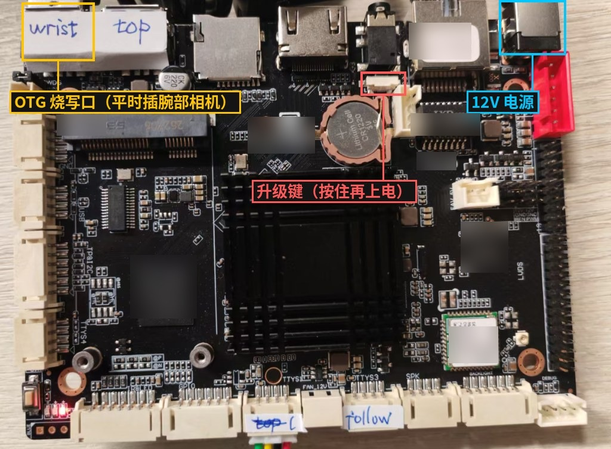

# 附录 恢复出厂系统

端侧计算平台出厂时已由 Xbotics 统一安装好系统与全部软件，日常更新只需执行 `xbotics-config update`（[1.1 节](#board-upgrade)），无需重新烧写系统。

本页仅用于特殊情况：端侧计算平台无法启动、系统损坏，或经 Xbotics 确认需要恢复出厂状态。**出厂镜像不开放下载**，如确需恢复，请通过购买渠道联系 Xbotics，我们会提供镜像、烧写工具与驱动。

烧写会清除端侧计算平台上的全部内容，包括录制的数据与机械臂标定，需要保留的请先拷出。

## 准备

| 所需物品 | 说明 |
| --- | --- |
| 电脑 | Windows 10 / 11，至少一个 USB 口 |
| 烧写线 | USB-A 公对公数据线，建议使用带屏蔽的 |
| 电源 | 端侧计算平台的 12V 电源 |
| 镜像、烧写工具与驱动 | 由 Xbotics 提供，按随附的说明在电脑上安装驱动（每台电脑一次） |

## 步骤

1. **连接：** 拔下腕部相机，因为烧写口就是平时连接腕部相机的 USB 口。烧写线一端接该接口，另一端接电脑。
2. **进入烧写模式：** 端侧计算平台能正常开机时，在网页终端中执行 `reboot loader`；无法启动时，先断电，按住升级键不放，接上 12V 电源，待烧写工具提示发现设备后再松开。
3. **烧写：** 在烧写工具中选择镜像文件，按随附说明设置后开始写入。写入完成后端侧计算平台自动重启。过程中不要拔线、不要断电；如果失败，重新进入烧写模式再烧写一遍。
4. **首次开机：** 接回腕部相机，接通电源。首次开机会整理存储空间，耗时比平时略长。随后按第 1 章连接热点、联网，并执行一次 `xbotics-config update`，将软件更新到最新版本；机械臂需重新标定（[1.6 节](#hardware-calibrate)）。

