# 第 1 章 硬件准备

星禾套件由主从两条机械臂、两路相机和一台端侧计算平台组成，机械臂与相机都连接在端侧计算平台上。端侧计算平台出厂时已安装好系统与全部软件，不接显示器，所有操作都在浏览器中完成：你只需要一台能够打开网页的电脑或手机，无需安装任何软件。

本章先介绍端侧计算平台的管理命令 `xbotics-config`，再完成联网、接线、硬件检测与机械臂标定，最后用遥操作检查一遍。完成后，这套硬件即可用于录制数据与部署模型。

端侧计算平台上的网页服务端口连号，顺序为「网络设置 → 终端 → Jupyter → VS Code → 硬件检测 → 标定」，记住起始的 8001 即可：

| 网址 | 用途 | 可打开的时机 |
| --- | --- | --- |
| `http://10.42.0.1` | 网络设置：连接 Wi-Fi、设置网线、连接训练电脑、查看地址 | 已连接端侧计算平台的热点时 |
| `http://<端侧IP>:8001` | 同一个网络设置页 | 开机后 |
| `http://<端侧IP>:8002` | 网页终端 | 服务开启时 |
| `http://<端侧IP>:8003` | JupyterLab | 服务开启时 |
| `http://<端侧IP>:8004` | 浏览器版 VS Code | 服务开启时 |
| `http://<端侧IP>:8005` | 硬件检测 | 服务开启时 |
| `http://<端侧IP>:8006` | 网页标定 | 服务开启时 |
| `http://<端侧IP>:8007` | 推理控制台 | 部署期间，见 [3.3 节](#deploy-console) |
| `http://<端侧IP>:6006` | 训练电脑上的 TensorBoard | 已连接训练电脑时，见 [3.2 节](#connect-server) |
| `http://<端侧IP>:9090` | 录制预览：相机画面与关节曲线 | 遥操作、录制数据期间 |

`<端侧IP>` 为端侧计算平台的地址：连接其热点时为 `10.42.0.1`，接入你的网络后为 1.2 节中显示的地址；局域网中也可以用 `xbotics-XXXX.local` 代替（后四位与热点名相同）。用户名为 `root`，默认密码为 `123456`，网页终端、JupyterLab、VS Code 与 SSH 均使用该密码。请只在自己的局域网中使用，不要将这些端口映射到公网。

(xbotics-config)=
## 1.1 xbotics-config：查看状态、开关服务与升级

`xbotics-config` 是端侧计算平台的管理命令，在网页终端中执行。

**打开网页终端：** 接通电源，用电脑或手机连接名为 `Xbotics-` 加四位字符的热点（无需密码），在浏览器中打开 `http://10.42.0.1:8002`。在 `login:` 后输入 `root`，再输入密码 `123456`（输入时屏幕不显示）。提示符前出现 `(xbotics-board)`，表示已进入 LeRobot 环境，后续命令可以直接执行。

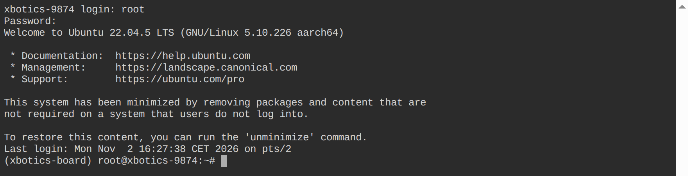

网页终端的用法与普通终端相同：可以粘贴命令，按 `Ctrl+C` 中断正在运行的命令。**关闭该网页时，其中正在运行的命令也会随之结束**，因此录制数据、部署期间不要关闭它。

**查看状态：**

```bash
xbotics-config status
```

输出列出各网页服务是否开机自启、是否正在运行及其网址；最后几行 `tunnel@<编号>` 是已连接的训练电脑，见 [3.2 节](#connect-server)。

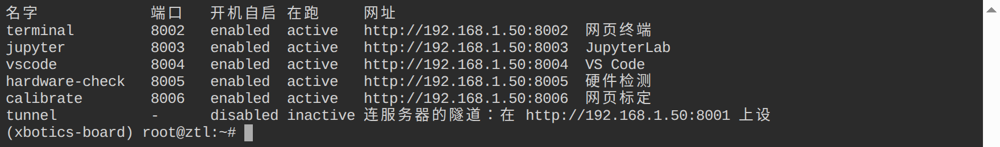

**开关网页服务：** 8002 至 8006 五个网页服务默认全部开启。执行不带参数的 `xbotics-config`，弹出菜单：用方向键上下选择，空格勾选或取消，回车生效。勾选的服务保持开启并开机自启；取消勾选的服务立即关闭，开机也不再启动。8001 网络设置页不在菜单中，它始终开启，以便随时通过热点修改网络。

```bash
xbotics-config
```

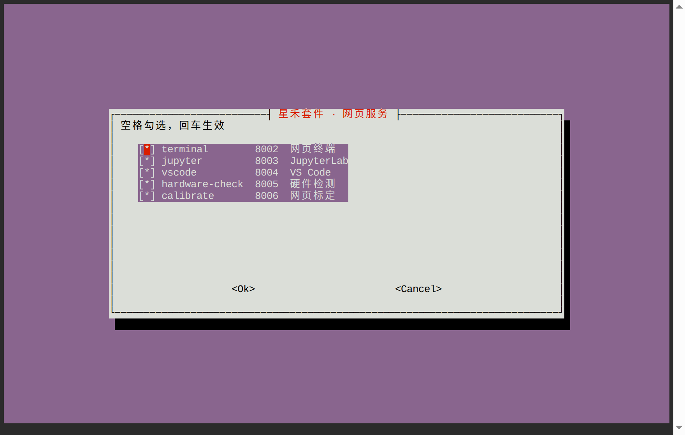

也可以直接执行命令，服务名为 `terminal`、`jupyter`、`vscode`、`hardware-check`、`calibrate`，`all` 表示全部：

```bash
xbotics-config disable calibrate
xbotics-config enable calibrate
```

不需要的服务可以关闭以节省内存，硬件检测、网页标定各占用约 0.3 GB。如果在网页终端中关闭了 `terminal`，页面会在两秒后断开；需要重新开启时，在 VS Code 的终端中执行 `xbotics-config enable terminal`。

(board-upgrade)=
**升级：** 端侧计算平台上的全部内容（系统设置、机械臂与相机的固定名字、网页服务、LeRobot 环境）都随 LeRobot 一同发布。维护版更新时，在端侧计算平台联网后执行（联网见 1.2 节）：

```bash
xbotics-config update
```

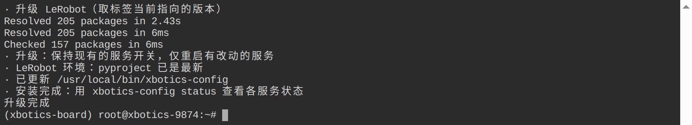

它将 LeRobot 更新到最新版本，再按新版更新端侧计算平台上的其余内容，只修改有变化的部分。网页服务的开关、修改过的密码、你自行用 `uv add` 安装的包都会保留。需要重启网页服务时，会在升级完成后再重启，页面短暂断开，刷新即可。训练电脑需同步升级，见 [2.7 节](#train-env-upgrade)。

(board-network)=
## 1.2 配网

连接端侧计算平台的热点后，电脑或手机会自动弹出「星禾套件 · 网络设置」页；如未弹出，在浏览器中打开 `http://10.42.0.1`。如果提示「此网络无法访问互联网」，请选择保持连接：该热点仅供设置使用，本身不连通外网。

页面顶部的三块状态卡每两秒刷新一次，右上角的标签显示状态：网线与 Wi-Fi 为绿色「可访问外网」、橙色「无法访问外网」或红色「未连接」，下方为获得的地址；本热点显示热点的名称与地址。状态卡下方是「Wi-Fi」「网线」「连接服务器」「打开网页」四个标签，一次显示一项设置。

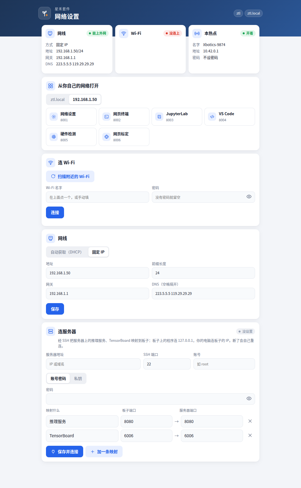

**连接 Wi-Fi：** 在「Wi-Fi」标签中点击「重新扫描」，列表按信号强弱排序，右侧格数表示信号强度，带锁的需要密码。选择你的 Wi-Fi，填写密码（右侧的眼睛图标可显示密码），点击「连接」。屏幕底部显示 `已连接 …，地址 …` 即表示成功。连接过程中热点不会中断，页面保持打开；密码错误时会给出提示。连接过的 Wi-Fi 列在「已保存」中，开机后自动连接；不再需要时，点击名称旁的 ×。标有「需账号登录，暂不支持」的网络需要用户名登录，目前无法连接。

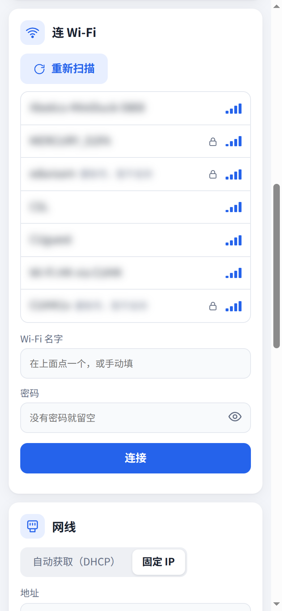{width=320px}

**使用网线：** 出厂设置为固定 IP `192.168.50.1`，用于网线直连电脑：用网线将端侧计算平台与电脑直接相连，把电脑的有线网卡设为固定 IP `192.168.50.2`、子网掩码 `255.255.255.0`，即可打开 `http://192.168.50.1:8001`。接入路由器使用时，在「网线」标签中点击「自动获取（DHCP）」再点击「保存」，端侧计算平台即从路由器获得地址。

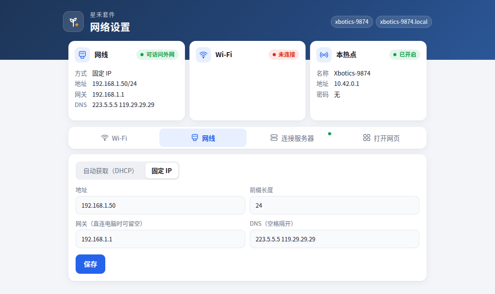

**从你的网络中打开各个网页：** 联网后，「打开网页」标签列出各个网页。上方一排是端侧计算平台的各个地址，选择哪个地址，下方的链接就使用哪个地址。将电脑切换回你自己的 Wi-Fi 或网线，再点击这些链接。带 `.local` 的地址需要电脑支持此类名称，无法打开时请选择 IP 地址。连接训练电脑后，这里还会列出 TensorBoard 等网页。

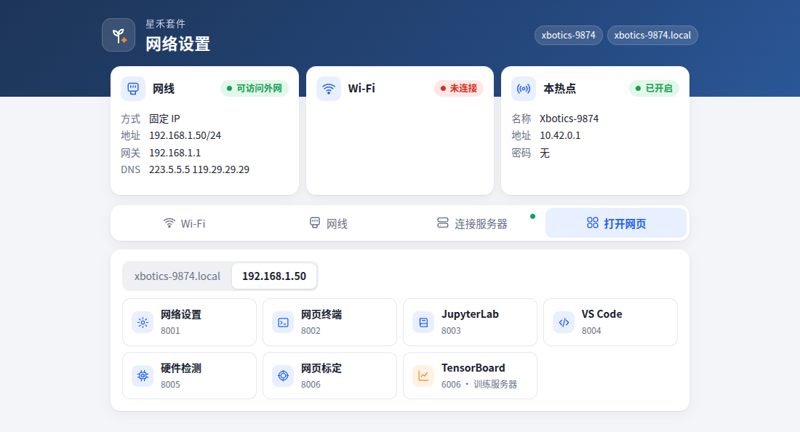

## 1.3 VS Code 与 JupyterLab

**浏览器版 VS Code** 适合查看文件、修改代码、编写需要反复使用的脚本。在浏览器中打开 `http://<端侧IP>:8004`，输入密码 `123456`。

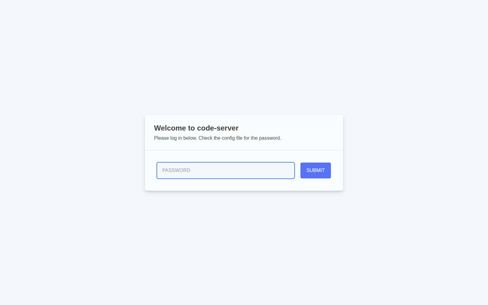

- **查看文件**：左侧 Explorer 显示端侧计算平台上的文件；切换目录可使用菜单 File → Open Folder
- **修改文件**：打开后直接编辑，按 `Ctrl+S` 保存
- **运行 Python 文件**：打开后点击编辑区右上角的 ▷，默认使用 LeRobot 环境中的 Python
- **终端**：菜单 Terminal → New Terminal，录制数据、部署的命令也可以在此执行

示例：在 `~/xbotics` 中新建 `check_board.py`，写入下面几行，点击 ▷。

```python
"""自检：使用的 Python、LeRobot 版本，以及四个固定名字各指向的设备。"""

import os
import sys

import lerobot

print("Python:", sys.executable)
print("LeRobot:", lerobot.__version__)
for name in ("follower", "leader", "top", "wrist"):
    path = f"/dev/xbotics/{name}"
    print(f"{path:24s}", "->", os.path.realpath(path) if os.path.exists(path) else "未连接")
```

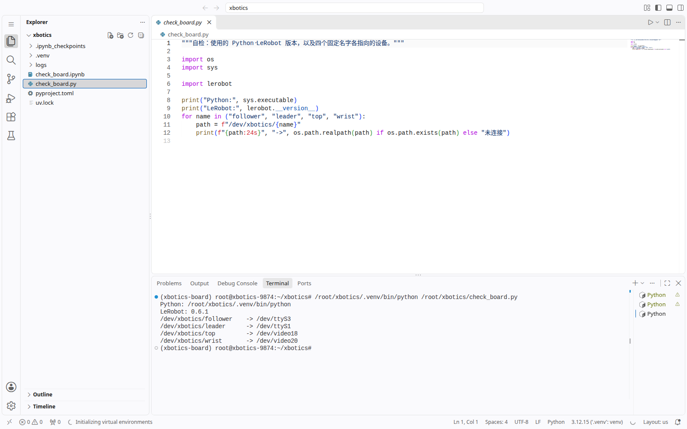

**JupyterLab** 适合边运行边查看结果，例如读取一组关节读数、查看一帧相机画面。在浏览器中打开 `http://<端侧IP>:8003`，输入密码 `123456`。

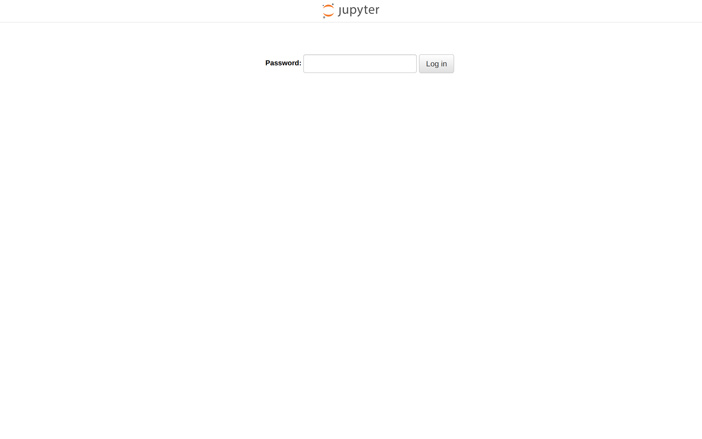

- **新建 notebook**：点击左上角蓝色的 `+`，在 Notebook 下选择 `Python 3 (ipykernel)`，可直接 `import lerobot`
- **运行**：在单元格中编写代码，按 `Shift+Enter` 运行该单元格

将上面 `check_board.py` 的代码粘贴到一个单元格中，按 `Shift+Enter`：

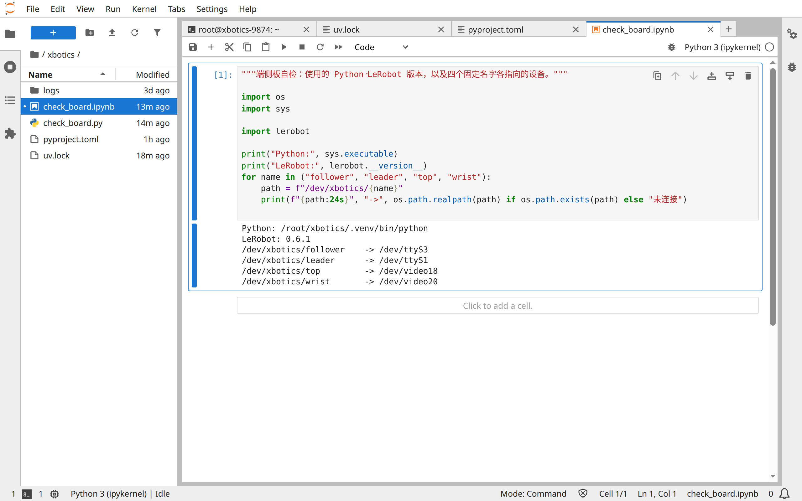

关闭网页后，notebook 的内核仍在后台运行，下次打开可以继续使用。不再使用时，通过菜单 Kernel → Shut Down Kernel 关闭内核：导入 LeRobot 后，一个内核约占用 0.4 GB 内存。

## 1.4 接线

两路相机接左上角的双 USB 口，两条机械臂接下沿的两个串口座。

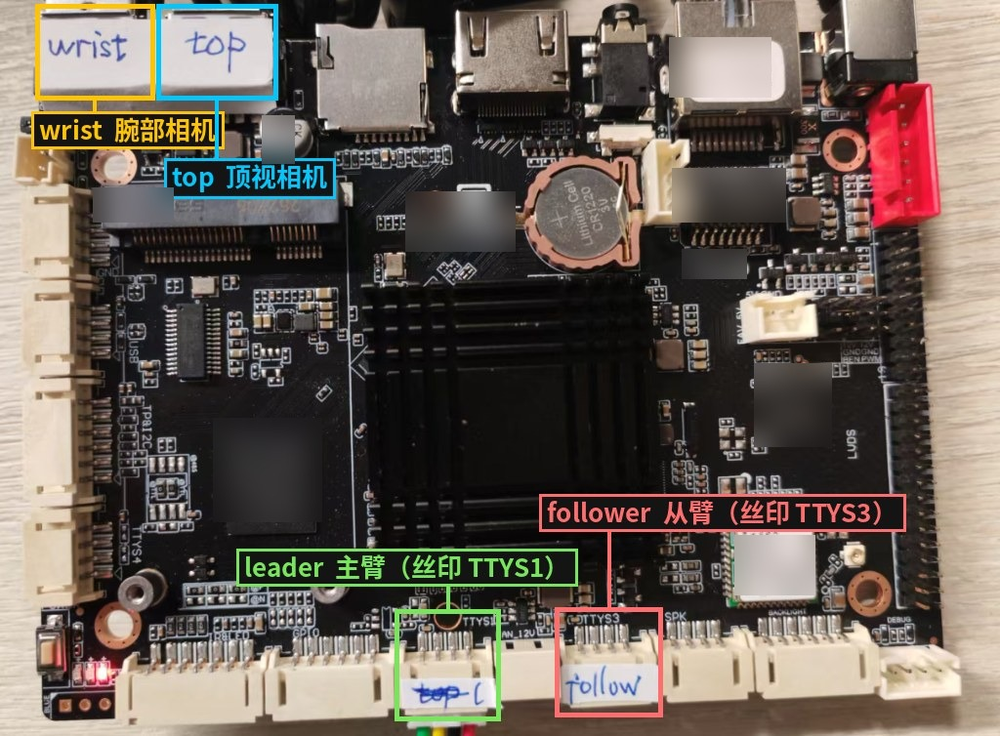

| 设备 | 接口 | 命令中的写法 |
| --- | --- | --- |
| 从臂（执行动作的一条） | 下沿丝印 TTYS3 的串口座 | `/dev/xbotics/follower` |
| 主臂（操作者握持的一条） | 下沿丝印 TTYS1 的串口座 | `/dev/xbotics/leader` |
| 顶视相机 | 双 USB 口右侧 | `/dev/xbotics/top` |
| 腕部相机 | 双 USB 口左侧 | `/dev/xbotics/wrist` |

名字按接口识别，而不按设备识别。两只相机的接口插反时，名字随之互换，录制的顶视与腕部画面也会互换。在网页终端中检查：

```bash
ls -l /dev/xbotics/
```

四个名字均存在且各指向一个设备，即为正确。两个串口的名字始终存在；相机未连接时，其名字不会出现。

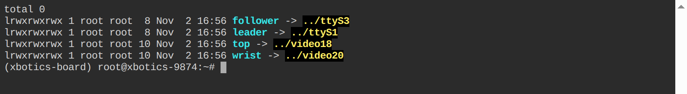

## 1.5 硬件检测

在浏览器中打开 `http://<端侧IP>:8005`：

- **摄像头**：每路相机一张实时画面，标题为固定名字与分辨率。两路均有画面，且名字与接口图一致，即表示相机连接正确。
- **串口**：列出两条机械臂的串口与固定名字。
- **读电机**：点击串口所在行的「读电机」，下方列出该机械臂上每个舵机的位置、电压、温度、电流、负载与报警。6 个舵机均存在、状态码均为 0、报警均为「无」，即为正常，从臂电压约 12 V。该操作只读不写，机械臂不会运动。

报警一列不为「无」时，表示该舵机过载、过热或电压异常，请先断电，待其冷却后检查是否卡住，再重新上电。提示「没有扫到舵机」时，表示该机械臂未上电或未接好。

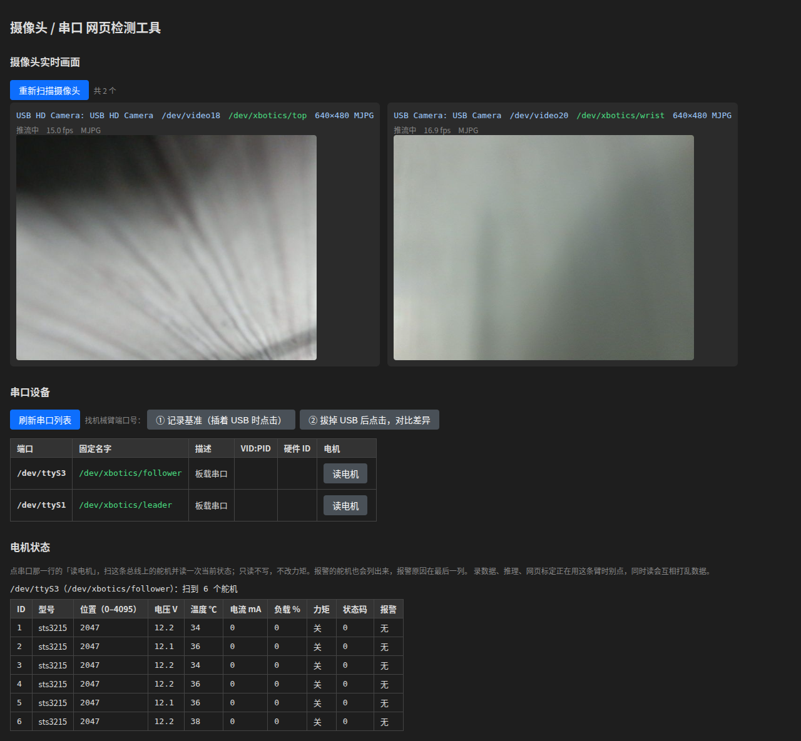

该页面打开期间相机被其占用，录制数据、部署前请先关闭该页面。

(hardware-calibrate)=
## 1.6 标定

每条机械臂首次使用前需标定一次。标定决定了舵机读数与真实关节角度之间的对应关系，后续录制的数据与部署的模型都依赖它。标定结果按 `id` 保存在端侧计算平台上，后续录制数据、部署时使用同一个 `id`，即会采用这次的标定。

在浏览器中打开 `http://<端侧IP>:8006`，依照 3D 模型逐步操作：

1. 选择「从臂」或「主臂」，串口默认为其固定名字。
2. **先用手托住机械臂**，再点击「开始标定」。连接后舵机立即卸力，不托住会使机械臂下落。
3. **中位**：依照中间的模型，将整条机械臂摆到各关节行程的中间位置，按回车。
4. **限位**：逐个关节进行，将当前关节缓慢转过两端，页面自动记录最小值与最大值，按回车记录该关节。腕部旋转可整圈转动，无需记录。转动范围不足的关节会标红，点击「重试」只重新标定该关节。
5. **写入**：全部通过后点击「写入标定」，写入舵机并读回核对，再保存为标定文件。

中途点击「取消会话」，舵机与标定文件均恢复到开始前的状态。标定期间，该机械臂不要同时用于录制数据、部署或硬件检测的「读电机」。

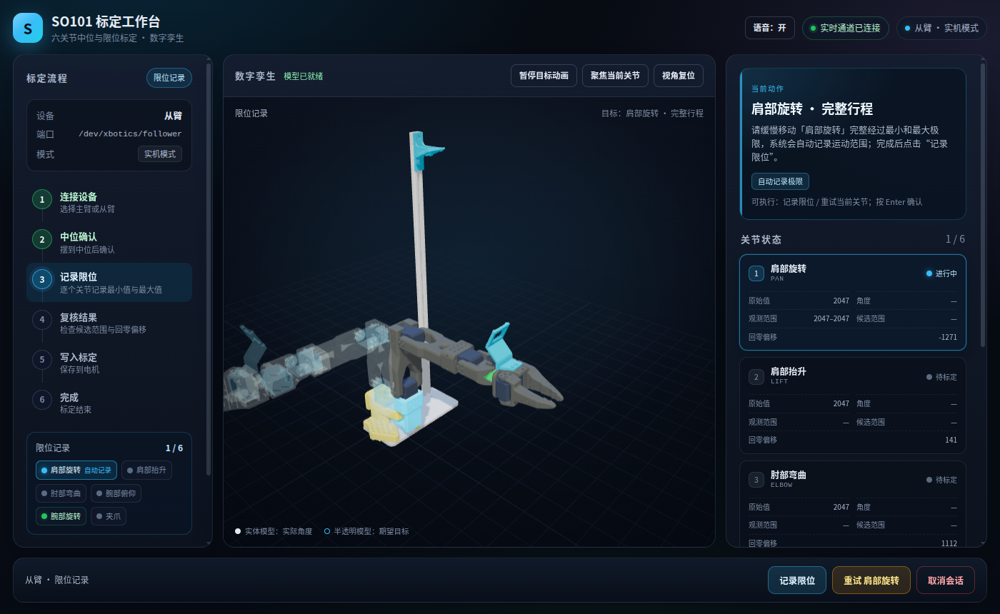

(camera-var)=
## 1.7 相机变量

将两路相机的设置保存在变量中，后续遥操作、录制数据与部署时直接使用 `$CAMERAS`。每次重新登录网页终端后都需重新执行：

```bash
CAMERAS="{ top: {type: opencv, index_or_path: /dev/xbotics/top, width: 640, height: 480, fps: 30, fourcc: MJPG}, wrist: {type: opencv, index_or_path: /dev/xbotics/wrist, width: 640, height: 480, fps: 30, fourcc: MJPG}}"
```

`top` 与 `wrist` 是相机在数据集中的名字。部署时须与训练模型所用的数据集保持一致，不要随意修改。

## 1.8 遥操作检查

遥操作是指操作者握持主臂运动，从臂实时跟随。用它检查一遍：两条机械臂、两路相机与标定均正确，即表示硬件准备完成。

```bash
lerobot-teleoperate \
  --robot.type=so101_follower --robot.port=/dev/xbotics/follower --robot.id=follower \
  --robot.cameras="$CAMERAS" \
  --teleop.type=so101_leader --teleop.port=/dev/xbotics/leader --teleop.id=leader \
  --display_data=true
```

`--robot` 为从臂，`--teleop` 为主臂，`id` 须与标定时一致。按 `Ctrl+C` 停止。

带有 `--display_data=true` 时，端侧计算平台会开启网页预览。在浏览器中打开 `http://<端侧IP>:9090`，即可看到两路相机画面与关节曲线，启动后需等待十余秒才能打开：

<video controls muted playsinline preload="metadata" poster="_static/poster/rerun.jpg" src="_static/media/rerun.mp4"></video>

逐项检查：

- 从臂能跟随主臂，没有明显的延迟与抖动
- 每个关节都能转到需要的位置，夹爪能完全张开与闭合
- 顶视相机能看到整个工作区：机械臂、物体与料盒都在画面中
- 腕部相机能看到夹爪与待抓取的物体

如有一项不符合，请回到前面各节重新检查接线或标定。四项均符合，这套硬件即可用于录制数据。
