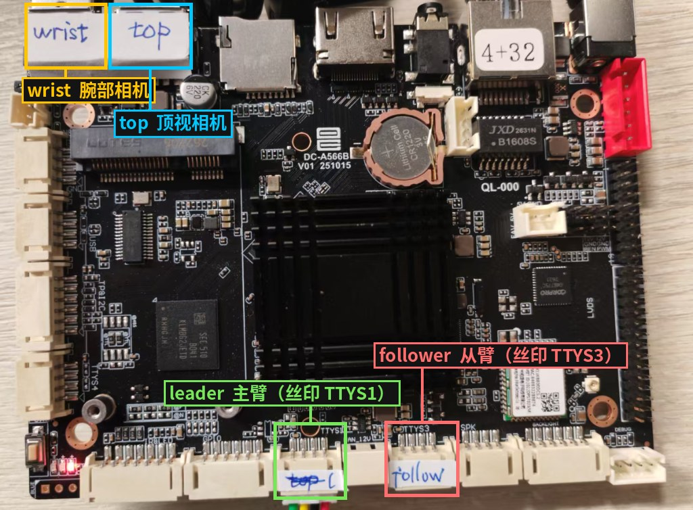
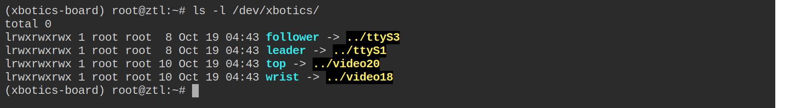
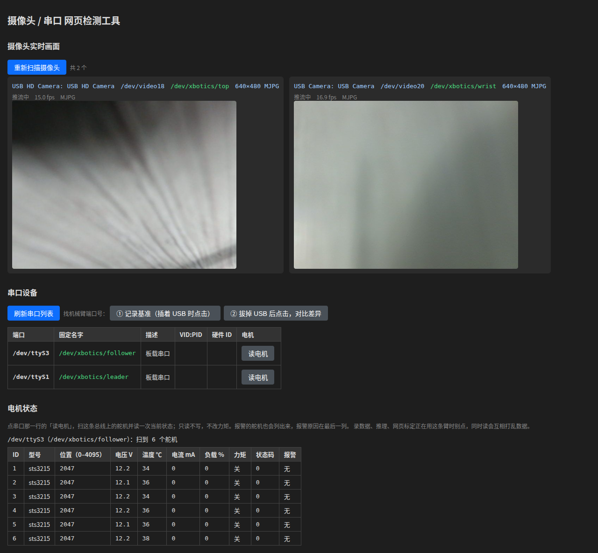
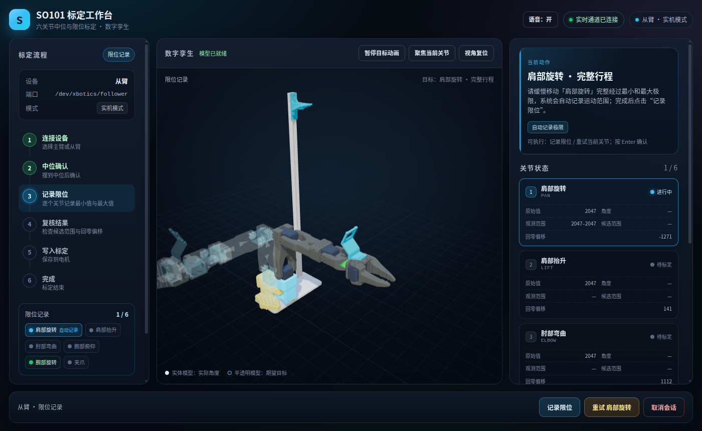

# 第 3 章 硬件准备

这一章把两条臂和两路相机接到板子上，确认硬件都正常，再标定机械臂。标定决定了舵机读数和真实关节角度的对应关系，后面录的数据和部署的模型都依赖它。这一章的命令都在板子的网页终端里敲。

## 3.1 接线

两路相机插左上角的双 USB 口，两条臂插下沿的两个串口座。



| 设备 | 插哪个口 | 命令里写 |
| --- | --- | --- |
| 从臂（执行动作的那条） | 下沿丝印 TTYS3 的串口座 | `/dev/xbotics/follower` |
| 主臂（人手拿着带的那条） | 下沿丝印 TTYS1 的串口座 | `/dev/xbotics/leader` |
| 顶视相机 | 双 USB 口的右边一个 | `/dev/xbotics/top` |
| 腕部相机 | 双 USB 口的左边一个 | `/dev/xbotics/wrist` |

名字按接口认，不按设备认。两只相机插反了口，名字就跟着反，录出来的顶视和腕部画面也是反的。检查：

```bash
ls -l /dev/xbotics/
```

四个名字都在、各指向一个设备就对了。两个串口的名字一直都在，相机没插时它的名字不会出现。



## 3.2 舵机编号

机械臂已经编好号时，可以跳过这一节。自己组装的机械臂要给每个舵机写上编号，这条命令会提示你逐个接上舵机：

```bash
lerobot-setup-motors --robot.type=so101_follower --robot.port=/dev/xbotics/follower
lerobot-setup-motors --teleop.type=so101_leader --teleop.port=/dev/xbotics/leader
```

## 3.3 硬件检测

浏览器打开 `http://<板子IP>:8005`：

- **摄像头**：每路相机一张实时画面，标题是固定名字和分辨率。两路都有画面，名字和接口图对得上，相机就接好了。
- **串口**：列出两条臂的串口和固定名字。
- **读电机**：点串口那一行的「读电机」，下面列出这条臂上每个舵机的位置、电压、温度、电流、负载和报警。6 个舵机都在、状态码都是 0、报警都是「无」，就是正常的，从臂的电压约 12 V。这个操作只读不写，机械臂不会动。

报警一列不是「无」，说明那个舵机在过载、过热或电压不对，先断电，等它凉下来，查一下是不是卡住了再上电。提示「没有扫到舵机」，说明这条臂没上电或没插好。



这个页面和录数据、推理不能同时用：页面开着时相机被它占着，录数据会拿不到画面。录之前先关掉这个页面。

## 3.4 相机变量

把两路相机记在变量里，后面录数据和部署都直接用 `$CAMERAS`。每次重新登录都要再敲一遍：

```bash
CAMERAS="{ top: {type: opencv, index_or_path: /dev/xbotics/top, width: 640, height: 480, fps: 30, fourcc: MJPG}, wrist: {type: opencv, index_or_path: /dev/xbotics/wrist, width: 640, height: 480, fps: 30, fourcc: MJPG}}"
```

`top` 和 `wrist` 是相机在数据集里的名字。部署时要和训练模型用的数据集一致，别随手改。

## 3.5 标定

每条臂第一次用之前标定一次。标定结果按 `id` 存在板子上，后面录数据、部署时写同一个 `id`，就会用这次的标定。有网页和命令行两种方式，结果是同一个文件，选一种就行。

**网页标定（推荐）：** 浏览器打开 `http://<板子IP>:8006`，照着 3D 模型一步一步来。

1. 选「从臂」或「主臂」，串口默认就是它的固定名字。
2. **先用手托住机械臂**，再点「开始标定」。连上后舵机马上卸力，不托着会塌下来。
3. **中位**：照中间的模型把整臂摆到各关节行程的中间，按回车。
4. **限位**：一个关节一个关节来，把当前关节缓慢转过两头，页面自动记下最小、最大值，按回车记下这个关节。腕部旋转能转整圈，不用记。哪个关节没转够会标红，点「重试」只重来这一个。
5. **写入**：全部通过后点「写入标定」，写进舵机、读回来核对，再存成标定文件。

中途点「取消会话」，舵机和标定文件都恢复到开始前的样子。标定时这条臂别同时被录数据、推理或硬件检测的「读电机」使用。



**命令行标定：** 按终端里的提示把各关节摆到中间，再把每个关节转过全程。

```bash
lerobot-calibrate --robot.type=so101_follower --robot.port=/dev/xbotics/follower --robot.id=follower
lerobot-calibrate --teleop.type=so101_leader --teleop.port=/dev/xbotics/leader --teleop.id=leader
```
