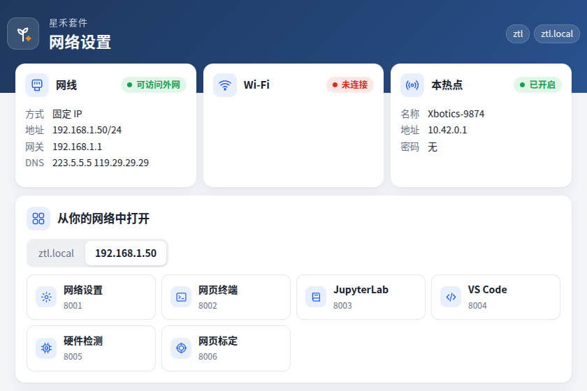
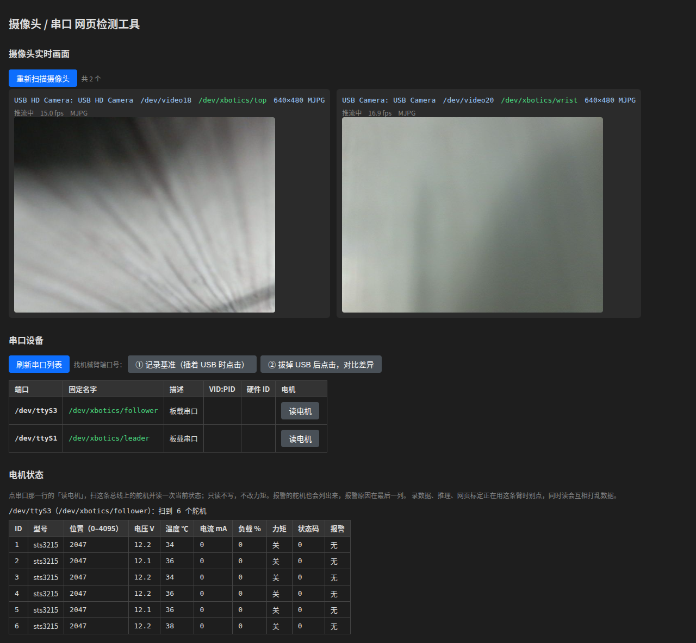
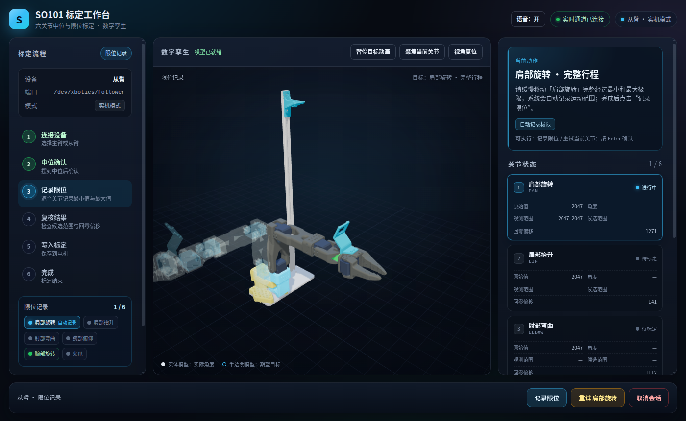
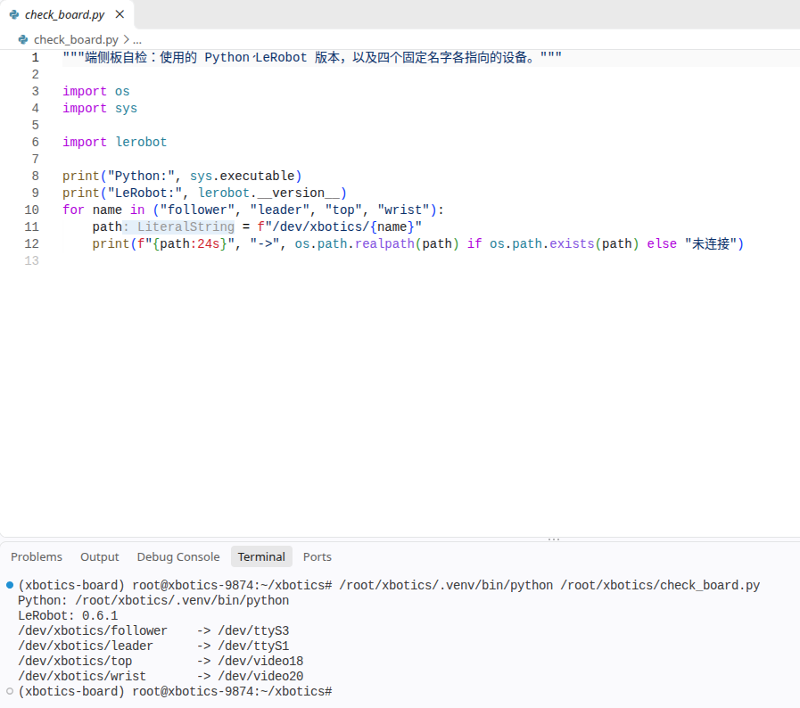
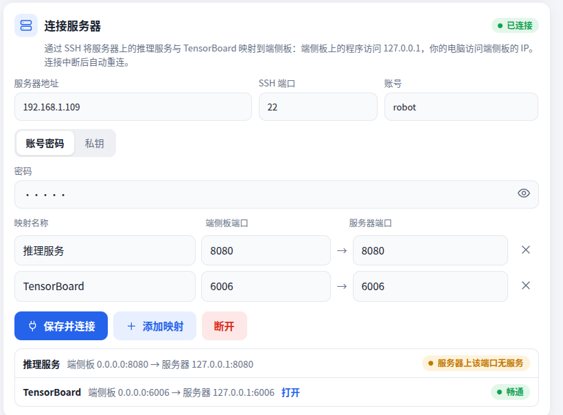
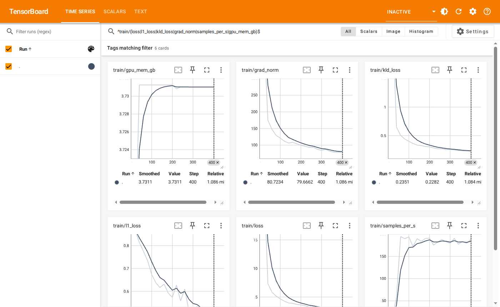
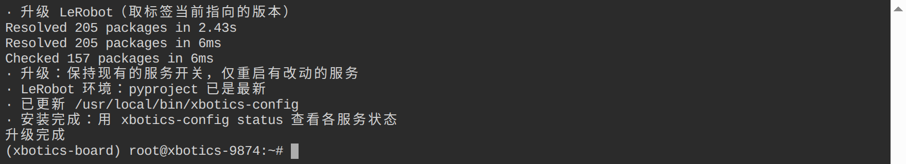

# Xbotics LeRobot：让 SO-101 自主完成任务

<video controls muted playsinline preload="metadata" poster="_static/poster/hook.jpg" src="_static/media/hook.mp4"></video>

Xbotics 维护的 LeRobot 把具身智能的完整流程整合为一套开箱即用的工具：在星禾套件上用主臂带动从臂示范动作并录制成数据，在一台配有 NVIDIA 显卡的电脑上训练模型，先在与真机对齐的 SO-101 仿真中评测，再由模型经网络控制真机。上面的视频展示了流程完成后的效果：模型仅依据两路相机画面与关节读数，自主将方块放入料盒。

本站介绍它的能力，并带你走通整条流程：准备硬件与训练电脑，录制数据，训练模型，再让模型经网络控制真机。

```{rubric} 所需硬件
```

| 部件 | 说明 |
| --- | --- |
| 主臂、从臂（星禾套件） | 一对 SO-101 机械臂：操作者握持主臂示范，从臂同步跟随 |
| 端侧计算平台（星禾套件） | 连接两条机械臂与两路相机，负责录制数据与执行动作 |
| 相机（星禾套件） | 顶视、腕部两路 USB 相机 |
| 训练电脑 | 你自己的 x86 电脑，配 NVIDIA 显卡：用于训练、仿真评测与推理 |

## 能力展示

### 依据画面自主完成抓取

模型每次读取两路相机画面与六个关节的读数，计算出接下来的一段动作；端侧计算平台逐一执行，并在当前一段用完之前获得下一段，机械臂动作连贯，每秒约 30 次动作。

<video controls muted playsinline preload="metadata" poster="_static/poster/deploy.jpg" src="_static/media/deploy.mp4"></video>

### 仿真与真机对齐

SO-101 仿真按真机搭建：机械臂模型、相机位置与视野、控制频率、关节单位均与真机一致。下面是同一集录制好的动作，左侧在真机上回放，右侧在仿真中回放：

<div class="video-row">
<video controls muted playsinline preload="metadata" poster="_static/poster/replay_real.jpg" src="_static/media/replay_real.mp4"></video>
<video controls muted playsinline preload="metadata" poster="_static/poster/replay_sim.jpg" src="_static/media/replay_sim.mp4"></video>
</div>

因此，仿真既可作为评测环境，在相同条件下运行数十局，给出可比较的成功率；也可作为一台机器人使用，在没有机械臂时完整走通录制数据与部署。我们发布的 ACT 模型使用真机与仿真数据训练，在 4 cm 方块场景中运行 50 局，成功率为 76%：

<video controls muted playsinline preload="metadata" poster="_static/poster/eval.jpg" src="_static/media/eval.mp4"></video>

### 开源的数据与模型

我们录制并开源了九个任务的 SO-101 真机数据：将电池、易拉罐、方块、橡皮、高尔夫球、药瓶、毛绒玩具放入料盒，以及两个堆叠任务，共 2200 集、约 78 万帧，每集均包含顶视与腕部两路画面。

<video controls muted playsinline preload="metadata" poster="_static/poster/ds9.jpg" src="_static/media/ds9.mp4"></video>

| 开源内容 | 获取位置 |
| --- | --- |
| 九任务真机数据 | ModelScope [`zhuzhuangtian/so101-pick-place-tasks`](https://modelscope.cn/datasets/zhuzhuangtian/so101-pick-place-tasks) |
| 仿真数据（4 cm 方块、2 cm 方块、4 cm 圆柱三个场景） | Hugging Face [`Harrysunshine/so101-sim-pickplace-v2`](https://huggingface.co/datasets/Harrysunshine/so101-sim-pickplace-v2) |
| ACT 模型（真机与仿真数据，方块任务） | Hugging Face [`Harrysunshine/so101-act-sim-real-cube`](https://huggingface.co/Harrysunshine/so101-act-sim-real-cube) |
| SmolVLA 模型（真机与仿真数据，十个任务，接受语言指令） | Hugging Face [`Harrysunshine/so101-smolvla-sim-real-10task`](https://huggingface.co/Harrysunshine/so101-smolvla-sim-real-10task) |

### 端侧计算平台只需一个浏览器

端侧计算平台不接显示器，所有操作都在浏览器中完成：连接它的热点后，网络设置页自动弹出；此后网页终端、浏览器版 VS Code、JupyterLab、硬件检测与网页标定都通过网址打开，你的电脑上无需安装任何软件。

<div class="shot-grid">
<figure><figcaption>网络设置：状态一目了然，Wi-Fi、网线、连接服务器、打开网页分标签设置</figcaption></figure>
<figure><figcaption>硬件检测：两路相机实时画面，一键读取每个舵机的状态</figcaption></figure>
<figure><figcaption>网页标定：依照 3D 模型逐个关节完成标定</figcaption></figure>
<figure><figcaption>浏览器版 VS Code：查看、修改、运行端侧计算平台上的代码</figcaption></figure>
</div>

### 连接一台或多台训练电脑

推理服务与训练曲线都在训练电脑上，二者可以在同一台电脑上，也可以分在两台。在端侧计算平台的网络设置页逐台添加，填写地址、账号与密码，各台电脑上的推理服务与 TensorBoard 即映射到端侧计算平台：其上的程序直接访问本机，在任意一台电脑上打开它的地址即可查看训练曲线。网络中断或重启后自动重新连接。

<div class="shot-grid">
<figure><figcaption>连接服务器：推理服务器与训练服务器各一张卡片，每一路映射的状态清晰可见</figcaption></figure>
<figure><figcaption>训练曲线：损失、梯度、吞吐与显存，训练过程中即可查看</figcaption></figure>
</div>

### 端侧计算平台稳定录制数据

端侧计算平台算力有限，原版 LeRobot 使用软件编码视频，在其上每秒只能编码约 11 帧。维护版在端侧计算平台上自动改用其自带的硬件编码器、每 10 帧计算一次画面统计量、将预览改为网页，两路 640×480 相机实测平均每秒 28.8 帧，命令无需添加任何参数。录制时可在浏览器中查看两路画面与关节曲线：

<video controls muted playsinline preload="metadata" poster="_static/poster/rerun.jpg" src="_static/media/rerun.mp4"></video>

### 低带宽下保持满速

部署时，相机画面经压缩后在后台发送，控制循环不等待网络。端侧计算平台与训练电脑之间的实测结果（ACT，两路 640×480 相机）：

| 网络 | 动作频率 | 动作间隔 p95 | 端侧平均上行 |
| --- | --- | --- | --- |
| 百兆局域网 | 29.4 Hz | 44 ms | 1.4 Mbps |
| 上行限 5 Mbps | 29.5 Hz | 44 ms | 1.0 Mbps |

原版同步发送原图时，在同样 5 Mbps 的限制下只有每秒 3.9 次动作。

### 出厂即用，一条命令升级

端侧计算平台出厂时已安装好全部软件。其上的全部内容（系统设置、机械臂与相机的固定名字、网页服务、LeRobot 环境）都随 LeRobot 一同发布，维护版更新时执行 `xbotics-config update` 即统一升级，服务开关、修改过的密码与自行安装的包均会保留。



### 支持的模型

| 模型 | 特点 |
| --- | --- |
| ACT | 一次预测一段动作，对显卡要求低，适合单任务入门 |
| Diffusion Policy | 用扩散模型生成动作，同一任务存在多种做法时更稳定 |
| SmolVLA | 视觉-语言-动作模型，读取任务描述，一个模型完成多个任务 |
| PI0 | 规模更大的视觉-语言-动作模型，支持多任务，显存要求较高 |

## 快速开始

按以下五章依次操作，即可从零走通录制、训练到部署：

1. **[硬件准备](hardware.md)**：xbotics-config、配网、网页终端与编辑器、接线、硬件检测、标定，并用遥操作完成检查
2. **[训练电脑](train-env.md)**：在配有 NVIDIA 显卡的电脑上安装 LeRobot 与 SO-101 仿真
3. **[录制数据](record.md)**：录制、回放、拷贝到训练电脑并查看；也可以直接使用开源数据
4. **[训练](train.md)**：训练 ACT 模型，用 TensorBoard 或 wandb 查看曲线
5. **[推理部署](deploy.md)**：启动推理服务，连接训练电脑，用推理控制台让模型控制真机

录制数据时如何设计任务、训练时如何选择模型与调整参数、评测与上真机前如何判断，属于 Xbotics 具身智能课程的内容，课程中将逐步讲解与实践。端侧计算平台需要恢复出厂系统时，见[附录](flash.md)。

## 版本

本站全部内容使用 Xbotics 维护的 LeRobot：分支 `xbotics-0.6`，标签 `xbotics-v0.6.1`，基于上游 LeRobot 0.6.1。端侧计算平台与训练电脑须使用同一个标签。代码与改动说明见 [GitHub](https://github.com/Xbotics-Embodied-AI-club/lerobot/tree/xbotics-0.6)。

```{toctree}
:hidden:
:maxdepth: 2

hardware
train-env
record
train
deploy
flash
```
