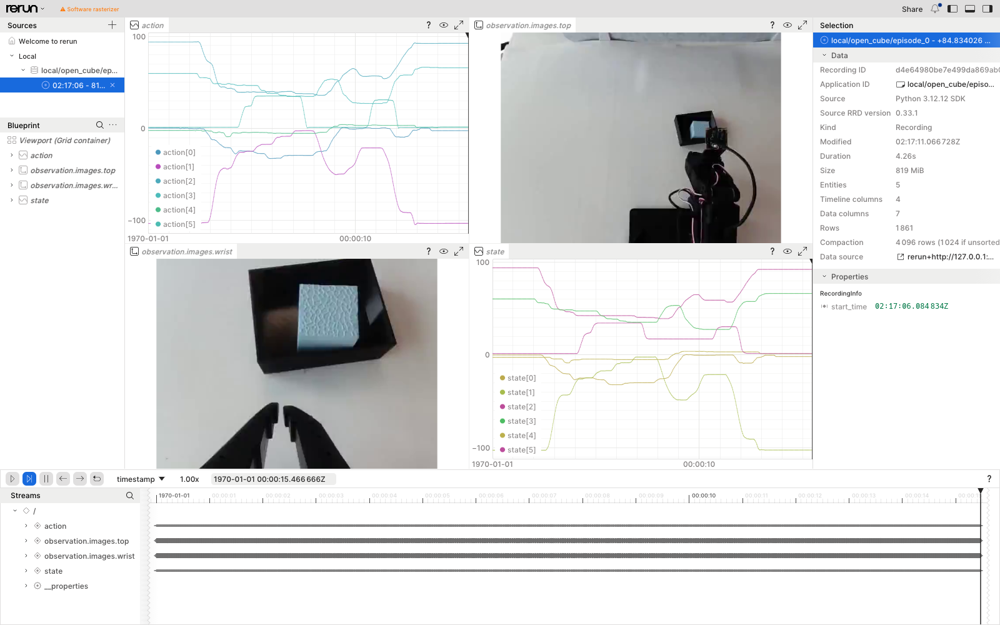

# 第 3 章 录制数据

录制时，操作者握持主臂完成任务，从臂同步跟随，端侧计算平台把两路相机画面、从臂的关节读数与主臂给出的动作一同保存为数据集。录好后可以在端侧计算平台上回放检查，再拷贝到训练电脑查看与训练。

本章的录制与回放在端侧计算平台的网页终端中执行，开始前请完成第 1 章，并设置相机变量（[1.7 节](#camera-var)）。没有机械臂、或想先走通后面的训练与部署，可以直接使用我们开源的数据，见 [3.5 节](#open-data)。

## 3.1 录制

```bash
lerobot-record \
  --robot.type=so101_follower --robot.port=/dev/xbotics/follower --robot.id=follower \
  --robot.cameras="$CAMERAS" \
  --teleop.type=so101_leader --teleop.port=/dev/xbotics/leader --teleop.id=leader \
  --dataset.repo_id=local/pick_cube --dataset.root=$HOME/data/pick_cube \
  --dataset.single_task="Pick up a cube and place in the bin" \
  --dataset.num_episodes=50 --dataset.episode_time_s=30 --dataset.reset_time_s=10 \
  --dataset.push_to_hub=false --dataset.streaming_encoding=true --display_data=true --play_sounds=false
```

| 参数 | 含义 |
| --- | --- |
| `--dataset.root` | 数据集保存的目录，即端侧计算平台上的 `~/data/pick_cube` |
| `--dataset.single_task` | 任务描述，接受语言指令的模型训练与部署时都会用到 |
| `--dataset.num_episodes` | 录制的集数。LeRobot 官方建议每个任务至少 50 集，物体每换一个摆放位置录 10 集 |
| `--dataset.episode_time_s` | 每集的时长（秒） |
| `--dataset.reset_time_s` | 两集之间留出的时间（秒），用于把物体摆回原处 |

按下回车后约半分钟才开始录制，这段时间在加载 LeRobot、连接相机与机械臂。录制过程中，在网页终端中按键：

| 按键 | 作用 |
| --- | --- |
| `→` 或 `n` | 提前结束这一集 |
| `←` 或 `r` | 重录这一集 |
| `Esc` 或 `q` | 结束录制，已录的各集连同正在录的这一集一并保存 |

在浏览器中另开一个页签，打开 `http://<端侧IP>:9090`，即可看到两路相机画面与关节曲线；时间轴持续向前推进，说明数据正在写入：

<video controls muted playsinline preload="metadata" poster="_static/poster/rerun.jpg" src="_static/media/rerun.mp4"></video>

同一个目录再次录制时会提示目录已存在。要在原数据集上继续追加，在原命令后加 `--resume=true`，此时 `--dataset.num_episodes` 填写**新增**的集数；要另录一批，更换 `--dataset.root` 与 `--dataset.repo_id`。

(record-replay)=
## 3.2 回放

回放让从臂按数据集中的某一集重新运动一遍，用于检查录下的动作是否完整。回放时只有从臂运动，主臂不参与：

```bash
lerobot-replay \
  --robot.type=so101_follower --robot.port=/dev/xbotics/follower --robot.id=follower \
  --dataset.repo_id=local/pick_cube --dataset.root=$HOME/data/pick_cube --dataset.episode=0
```

`--dataset.episode` 为集的编号，从 0 开始。回放前清空工作区，手放在电源开关旁。

(record-copy)=
## 3.3 拷贝到训练电脑

在**训练电脑**的终端中执行，密码为 `123456`：

```bash
mkdir -p ~/data && scp -r root@<端侧IP>:data/pick_cube ~/data/
```

完成后，训练电脑上的 `~/data/pick_cube` 即为这份数据集，后续查看与训练都使用这个路径。

(record-viz)=
## 3.4 查看数据

在训练电脑上进入环境（[2.2 节](#train-env-setup)），逐集查看录下的数据：

```bash
lerobot-dataset-viz --repo-id local/pick_cube --root ~/data/pick_cube --episode-index 0
```

随后弹出 Rerun 查看器，中间四块依次为：主臂给出的动作（`action`）、顶视相机画面、腕部相机画面、从臂六个关节的读数（`state`）。拖动底部的时间轴可逐帧查看。`--episode-index` 为集的编号，从 0 开始。



(open-data)=
## 3.5 使用开源数据

我们录制并开源了九个任务的 SO-101 真机数据，格式与 3.1 节录制的数据相同，可以直接用于训练。在训练电脑上下载其中「将方块放入料盒」一个任务：

```bash
uvx modelscope download --dataset zhuzhuangtian/so101-pick-place-tasks \
  --include 'pick_up_a_cube_and_place_in_the_bin/*' --local_dir ~/data/so101-pick-place-tasks
```

下载后的数据集目录为 `~/data/so101-pick-place-tasks/pick_up_a_cube_and_place_in_the_bin`。查看与训练时，把命令中的 `~/data/pick_cube` 换成这个目录即可。
