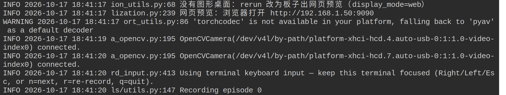

# 第 5 章 录数据

模仿学习的模型只能学到数据里有的东西，所以录数据决定了模型能做到什么程度。这一章先设计任务，再把遥操作录成数据集。

## 5.1 设计任务

录之前先定下这几件事：

- **任务和描述**：一句话写清楚要做什么，比如 `Pick up a cube and place in the bin`。带语言输入的模型会读这句话。
- **摆放范围**：物体和料盒在桌面上会出现在哪些位置。部署时物体放在这个范围以外，模型多半做不好。
- **集数**：一集就是一次完整的任务。可以先录几十集跑通流程，再根据效果增加。我们发布的 ACT 模型，真机部分用了 300 集。
- **固定的东西**：相机位置、光线、桌面背景要和部署时一致。相机一旦挪动，数据和模型都要重新来。

## 5.2 开始录

```bash
lerobot-record \
  --robot.type=so101_follower --robot.port=/dev/xbotics/follower --robot.id=follower \
  --robot.cameras="$CAMERAS" \
  --teleop.type=so101_leader --teleop.port=/dev/xbotics/leader --teleop.id=leader \
  --dataset.repo_id=local/pick_cube --dataset.root=$HOME/data/pick_cube \
  --dataset.single_task="Pick up a cube and place in the bin" \
  --dataset.num_episodes=10 --dataset.episode_time_s=30 --dataset.reset_time_s=10 \
  --dataset.push_to_hub=false --dataset.streaming_encoding=true --display_data=true --play_sounds=false
```

这条命令录 10 集，每集 30 秒，两集之间留 10 秒把场景摆回去。几个参数：

| 参数 | 作用 |
| --- | --- |
| `--dataset.single_task` | 这批数据的任务描述 |
| `--dataset.root` | 数据存在哪个目录 |
| `--dataset.streaming_encoding=true` | 视频边录边编，存盘几乎不用等 |
| `--display_data=true` | 打开录制预览 |
| `--play_sounds=false` | 关掉语音播报（板子没有喇叭） |

敲下回车后约半分钟才开始录，这段时间在加载 LeRobot、连相机和机械臂。板子上不用为硬件加参数，维护版自动用芯片的硬件编码器编视频，每 10 帧算一次画面统计量，并把预览改成网页。



## 5.3 录制时的操作

录的过程中，在网页终端里按键：

| 按键 | 作用 |
| --- | --- |
| `→` 或 `n` | 提前结束这一集 |
| `←` 或 `r` | 重录这一集 |
| `Esc` 或 `q` | 结束录制，正在录的这一集录到哪存到哪 |
| `Ctrl+C` | 强行中断，正在录的那一集丢掉，前面录完的还在 |

一集做坏了就按 `←` 重录，别留到后面再删。浏览器另开一个页签打开 `http://<板子IP>:9090` 可以看预览，内容和 4.2 节一样，最下方的时间轴一直往前走，说明数据在实时进来。

同一个目录再录一次会报目录已存在。要接着往里加，原命令后面加 `--resume=true`；要另起一批，换一个 `--dataset.root`。

## 5.4 怎样算一份好数据

下面是同一集的两路相机，这是一份合格数据的样子：任务完整，物体一直在画面里，动作连贯，夹爪张合明确。

<div class="video-row">
<video controls muted playsinline preload="metadata" src="_static/media/tele_top.mp4"></video>
<video controls muted playsinline preload="metadata" src="_static/media/tele_wrist.mp4"></video>
</div>

录的时候按这几条要求自己：

- **每一集都成功**：失败的集会教模型做错的动作，发现了就重录。
- **动作干脆**：中途停顿、来回犹豫都会被模型学进去，部署时表现为机械臂卡在半空。
- **覆盖摆放范围**：物体和料盒的位置要分散开，不要总摆在同一个地方。
- **手和杂物别进画面**：模型部署时看不到这些东西。
- **风格一致**：多人录数据时，抓取方向和路线尽量统一。

## 5.5 没有机械臂时用仿真

同一条 `lerobot-record`，把机器人换成仿真、把遥操作换成回放遥操器，就能录出一份格式完全相同的数据集。这一节在 x86 电脑上做：

```bash
REAL=~/data/so101-pick-place-tasks/pick_up_a_cube_and_place_in_the_bin
lerobot-record \
  --robot.type=so101_sim --robot.discover_packages_path=so101_sim \
  --teleop.type=so101_dataset_player --teleop.discover_packages_path=so101_sim \
  --teleop.repo_id=local/pick_cube --teleop.root=$REAL --teleop.episode=0 \
  --dataset.repo_id=local/demo_a --dataset.root=$HOME/data/demo_a \
  --dataset.single_task="Pick up a cube and place in the bin" \
  --dataset.num_episodes=2 --dataset.episode_time_s=8 --dataset.reset_time_s=0 \
  --dataset.push_to_hub=false --dataset.streaming_encoding=true --play_sounds=false
```

把 `demo_a` 都换成 `demo_b` 再跑一次，就得到第二份数据，6.4 节合并时会用到。
