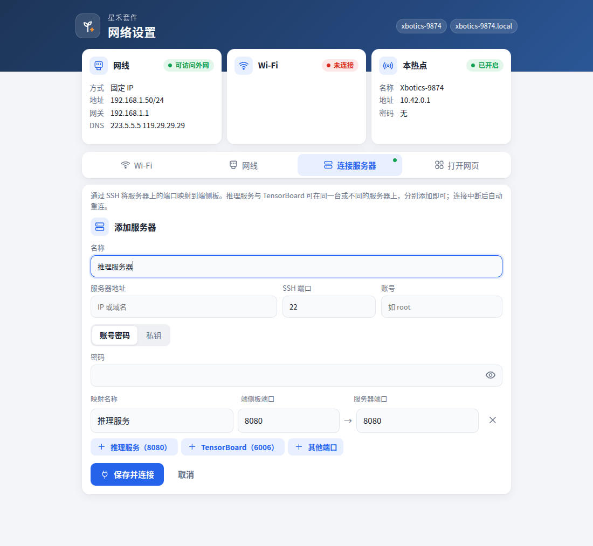
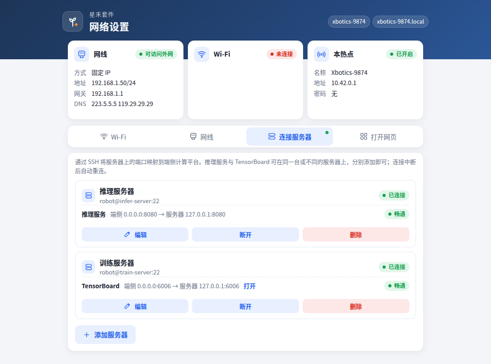

# 第 2 章 训练电脑

训练、仿真评测与推理都在一台配有 NVIDIA 显卡的 x86 电脑上进行，操作系统为 Ubuntu，下称**训练电脑**。整个流程会用到三台设备：

| 设备 | 做什么 | 怎么操作 |
| --- | --- | --- |
| 端侧计算平台 | 连接机械臂与相机，录制数据、执行动作 | 在浏览器中打开它的网页终端 |
| 训练电脑 | 训练模型、运行推理服务 | 坐在它前面直接用，或从你的电脑经 SSH 登录 |
| 你的电脑或手机 | 打开各个网页：网页终端、训练曲线、推理控制台 | 浏览器 |

训练电脑可以就在你身边（接显示器的台式机），也可以在机房或云上、只能经 SSH 登录。两种情况的做法只在少数几处不同，本书在这些地方分开写明。本章的命令都在**训练电脑的终端**中执行。

## 2.1 显卡驱动

```bash
nvidia-smi
```

能列出显卡，且右上角的 `CUDA Version` 不低于 12.8，即可继续。版本较低时，请先升级驱动。

(train-env-setup)=
## 2.2 建立环境

使用 uv 管理 Python 与依赖。先安装系统工具与 uv：

```bash
sudo apt install -y git ffmpeg curl tmux
curl -LsSf https://astral.sh/uv/install.sh | sh
source ~/.local/bin/env
```

建立项目目录，并写明需要安装的内容：

```bash
mkdir -p ~/xbotics && cd ~/xbotics
cat > pyproject.toml <<'EOF'
[project]
name = "xbotics-train"
version = "0.0.0"
requires-python = "==3.12.*"
dependencies = ["lerobot[training,evaluation,dataset,viz,async,smolvla,feetech,xbotics_tools]"]

[tool.uv]
package = false

[tool.uv.sources]
lerobot = { git = "https://github.com/Xbotics-Embodied-AI-club/lerobot.git", tag = "xbotics-v0.6.1" }
EOF
uv sync
source .venv/bin/activate
```

各可选组的作用：

| 组 | 作用 |
| --- | --- |
| `training`、`evaluation` | 训练与评测，查看训练曲线所用的 TensorBoard 与 wandb 也包含在 `training` 中 |
| `dataset`、`viz` | 读写数据集、查看数据 |
| `async` | 推理服务 |
| `smolvla` | SmolVLA 模型 |
| `feetech` | 舵机驱动 |
| `xbotics_tools` | 网页硬件检测、网页标定、推理控制台 |

SO-101 仿真随 LeRobot 一同安装，无需另行安装。此后每打开一个新终端（或新的 SSH 窗口），都先执行下面一行进入环境，本书后面的命令默认已进入环境：

```bash
cd ~/xbotics && source .venv/bin/activate
```

## 2.3 检查

```bash
python -c "import lerobot, torch, so101_sim; print('lerobot', lerobot.__version__, '| torch', torch.__version__, '| cuda', torch.cuda.is_available())"
python -c "import gymnasium as gym, so101_sim; gym.make('SO101PickPlaceCube40-v1').reset(seed=0); print('ok')"
```

第一行应输出 `lerobot 0.6.1` 与 `cuda True`，第二行输出 `ok`，表示仿真可以运行。若出现 `cuda False`，请回到 2.1 检查驱动。

## 2.4 登录 Hugging Face

训练需要从 Hugging Face 下载预训练权重，模型与数据集也可以上传到 Hugging Face。建议登录，使用 PI0 模型时必须登录：

```bash
hf auth login
```

(train-env-ssh)=
## 2.5 开启 SSH 服务

端侧计算平台经 SSH 连接训练电脑：拷贝数据、查看训练曲线、部署都要用到。在训练电脑上安装 SSH 服务，并查看它的 IP：

```bash
sudo apt install -y openssh-server
hostname -I
```

记下 `hostname -I` 输出的第一个地址（下称 `<训练电脑IP>`），以及你登录这台电脑所用的用户名与密码。云服务器通常已开启 SSH，`<训练电脑IP>` 用服务商给出的地址。端侧计算平台必须能访问这个地址：两者在同一个局域网中，或训练电脑有公网地址。

(connect-server)=
## 2.6 让端侧计算平台连接训练电脑

这一步让端侧计算平台把训练电脑上的两个服务转发到自己身上：

- **TensorBoard（6006）**：你的电脑打开 `http://<端侧IP>:6006` 即可看到训练曲线，训练电脑在远处时也一样；
- **推理服务（8080）**：部署时端侧计算平台上的推理控制台经它访问推理服务。

在你的电脑或手机上打开端侧计算平台的网络设置页（[1.2 节](#board-network)），进入「连接服务器」标签：

1. 点击「添加服务器」，填写**名称**（便于区分，如「训练电脑」）、**服务器地址**（`<训练电脑IP>`）、**SSH 端口**（通常为 22）、**账号**（训练电脑上的用户名）。
2. 登录方式选择**账号密码**，填写该账号的密码。也可以选择**私钥**，将私钥完整粘贴进去，或点击「选择文件」。
3. 在表单下方点击「推理服务（8080）」与「TensorBoard（6006）」，添加两条映射。



4. 点击「保存并连接」。几秒后卡片右上角变为绿色「已连接」，每条映射标出状态：「畅通」表示训练电脑上该服务正在运行；「服务器上该端口无服务」表示连接已建立，只是训练电脑上还没有启动该服务（启动 TensorBoard 见 [4.2 节](#train-curves)，启动推理服务见 [5.1 节](#deploy-server)），启动后自动变为「畅通」。

推理与训练也可以分在两台电脑上，每台分别添加一次，各自映射对应的服务。下图是这种情况：推理服务器提供推理服务，训练服务器提供 TensorBoard。



连接会一直保持：网络中断或训练电脑重启后自动重新连接，端侧计算平台重启后也会自动连接。每张卡片可以「编辑」「断开」「删除」。连接失败时，卡片中以中文给出原因：

| 提示 | 处理 |
| --- | --- |
| 登录被拒 | 账号或密码不正确。修改后再次点击「保存并连接」；端侧计算平台不会用错误的密码反复重试，避免训练电脑锁定该账号 |
| 找不到该服务器地址、连不上服务器 | 地址填写错误，或端侧计算平台访问不到训练电脑，见 2.5 节 |
| 服务器指纹已变化 | 训练电脑重新安装过系统，再次点击「保存并连接」即可 |

(train-env-upgrade)=
## 2.7 升级

端侧计算平台升级时（[1.1 节](#board-upgrade)），训练电脑也需同步升级，保持同一版本：

```bash
cd ~/xbotics && uv lock --upgrade-package lerobot && uv sync
```
