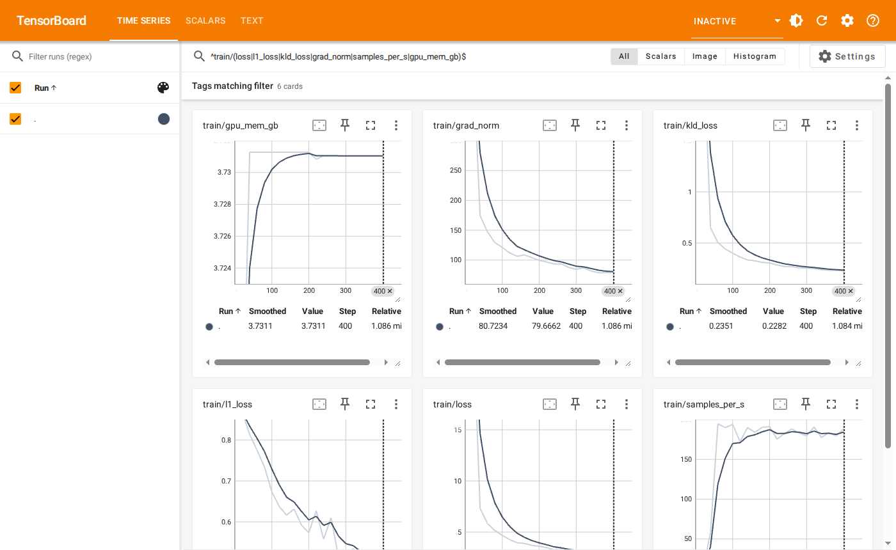

# 第 4 章 训练

本章在训练电脑上用录好的数据训练一个 ACT 模型，训练过程中查看曲线，训练完成后得到可以部署的模型。训练命令在**训练电脑的终端**中执行，查看曲线在**你的电脑或手机的浏览器**中进行。

(train-run)=
## 4.1 开始训练

训练电脑在远处、经 SSH 登录时，先执行 `tmux new -s train` 进入一个 tmux 会话，再在其中启动训练：这样关掉 SSH 窗口或网络断开，训练也不会中断。之后需要回来查看时，重新 SSH 登录并执行 `tmux attach -t train`；在会话中按 `Ctrl+B` 后再按 `D` 即可离开，训练继续运行。训练电脑就在身边时，直接在终端中执行即可。

```bash
cd ~/xbotics && source .venv/bin/activate
lerobot-train \
  --dataset.repo_id=local/pick_cube --dataset.root=$HOME/data/pick_cube \
  --policy.type=act --policy.device=cuda --policy.push_to_hub=false \
  --output_dir=outputs/train/act_pick_cube --job_name=act_pick_cube
```

| 参数 | 含义 |
| --- | --- |
| `--dataset.root` | 数据集目录：3.3 节拷贝来的 `~/data/pick_cube`，或 3.5 节下载的开源数据 |
| `--policy.type` | 模型类型，这里为 ACT |
| `--output_dir` | 训练结果保存的目录，每次训练使用一个新目录 |
| `--job_name` | 本次训练的名字，wandb 中以它区分各次训练 |

默认训练 100000 步，每 20000 步保存一次。在一块 RTX PRO 6000 显卡上每步约 0.045 秒，100000 步约 1.3 小时；显卡较弱时用时相应更长。

训练开始后，终端每 200 步输出一行，包含当前步数与损失；损失整体下降后趋于平稳属正常。按 `Ctrl+C` 可随时停止，已保存的结果保留。

(train-curves)=
## 4.2 用 TensorBoard 查看曲线

`lerobot-train` 默认把曲线写入输出目录下的 `tensorboard` 中，无需账号与网络。查看分两步：在训练电脑上启动 TensorBoard，再在浏览器中打开它。

**第一步，在训练电脑上启动 TensorBoard。** 另开一个终端（训练电脑在远处时，另开一个 SSH 窗口，同样建议在 tmux 中运行，例如 `tmux new -s tb`），执行：

```bash
cd ~/xbotics && source .venv/bin/activate
tensorboard --logdir outputs/train
```

终端显示 `TensorBoard ... at http://localhost:6006/` 即已启动，保持它运行。`--logdir` 指定 `outputs/train` 时，可同时比较多次训练。

**第二步，在浏览器中打开。** TensorBoard 只在训练电脑本机监听，按你所在的位置选择一种方式：

| 你在哪里 | 怎么打开 |
| --- | --- |
| 坐在训练电脑前 | 在训练电脑的浏览器中打开 `http://localhost:6006` |
| 在端侧计算平台所在的网络中，且已按 [2.6 节](#connect-server) 连接训练电脑 | 在你的电脑或手机上打开 `http://<端侧IP>:6006`，或在网络设置页「打开网页」标签中点击 TensorBoard |
| 在其他地方，能经 SSH 登录训练电脑 | 在你的电脑上另开一个终端执行 `ssh -N -L 6006:127.0.0.1:6006 <用户名>@<训练电脑IP>` 并保持窗口打开，再在浏览器中打开 `http://localhost:6006` |

第二种方式由端侧计算平台转发：网络设置页「连接服务器」中 TensorBoard 一条映射显示「畅通」，即可打开。第三种方式由你电脑上的 SSH 转发，Windows 在 PowerShell 中同样可以执行这条命令。



数秒内即可看到新的数据点。各条曲线的含义：

| 曲线 | 含义 |
| --- | --- |
| `train/loss` 及模型自身的分项损失 | 损失，整体下降后趋于平稳属正常 |
| `train/grad_norm`、`train/lr` | 梯度范数、当前学习率 |
| `train/samples_per_s`、`train/update_s`、`train/dataloading_s` | 每秒训练的帧数，每步用于更新模型与读取数据的时间（秒） |
| `train/gpu_mem_gb` | 显存占用 |

训练所用的完整配置记录在 TEXT 页。

(train-wandb)=
## 4.3 用 wandb 查看曲线

wandb 把曲线上传到它的网站，在任何地方的浏览器中登录即可查看，不需要任何转发，训练电脑在远处时最省事；前提是训练电脑能访问外网。先在 [wandb.ai](https://wandb.ai) 注册账号，在训练电脑上登录一次，按提示粘贴网页上给出的 API key：

```bash
wandb login
```

训练命令中加上 `--wandb.enable=true`：

```bash
lerobot-train \
  --dataset.repo_id=local/pick_cube --dataset.root=$HOME/data/pick_cube \
  --policy.type=act --policy.device=cuda --policy.push_to_hub=false \
  --output_dir=outputs/train/act_pick_cube --job_name=act_pick_cube \
  --wandb.enable=true
```

训练开始后，终端会给出本次训练的网址；也可以在 wandb 网站的 `lerobot` 项目中找到它。曲线的名字与 TensorBoard 相同，TensorBoard 照常写入，两者可同时使用。

(train-output)=
## 4.4 训练结果

训练结果保存在 `outputs/train/act_pick_cube/checkpoints` 中，每次保存一个以步数命名的目录，`last` 指向最近一次保存：

```text
outputs/train/act_pick_cube/checkpoints/
├── 020000/
├── 040000/
├── ...
└── last -> 100000
```

部署时使用其中的 `pretrained_model` 目录，例如 `~/xbotics/outputs/train/act_pick_cube/checkpoints/last/pretrained_model`，见 [5.2 节](#deploy-console)。

## 4.5 中断后继续训练

训练被中断后，从最近一次保存的位置继续，曲线在 TensorBoard 中接续：

```bash
lerobot-train \
  --config_path=outputs/train/act_pick_cube/checkpoints/last/pretrained_model/train_config.json \
  --resume=true
```
